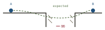
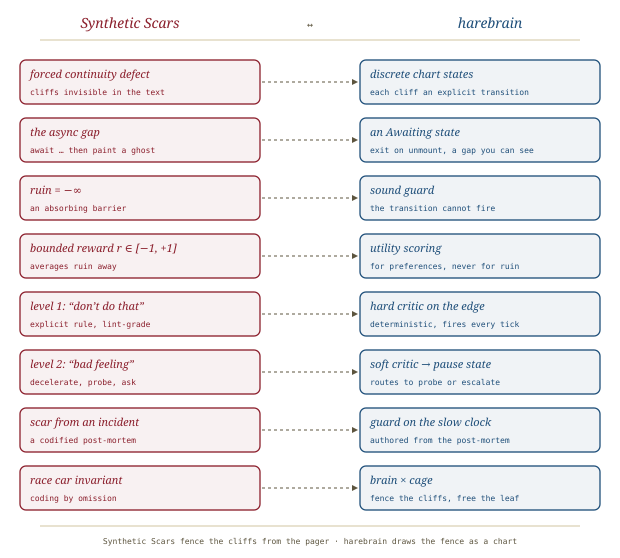

# The Happy-Path Mirage, *dispelled*

*Cliff notes on Randal L. Schwartz's "Why AI Coding Agents Crash at 3 AM: The Happy-Path Mirage & The Forced Continuity Defect" (dev.to, September 2026), Part 2 of the* Synthetic Scars *series. The piece explains why a fluent model walks off production cliffs and why more preference training won't stop it. For harebrain, its remedy (fence the cliffs so the brain can drive fast) is the brain × cage thesis argued from the pager.*

---

## The test the piece sets

Never judge code by how it runs at 2 PM on staging, the piece begins. Staging has five database connections, sub-millisecond latency, pristine JSON, and an immediate `200 OK` for everything. The real exam is **3 AM on a Saturday**: a payment gateway drops packets in Singapore, a user flings a list at 120 fps while the OS reclaims memory, and a lock timeout takes down twelve workers in a thundering herd.

Part 1 ([[teaching-pain]]) named the symptom, *the Straight-A Intern Paradox*: textbook code in seconds that disintegrates on contact with a real codebase. Part 2 is the diagnosis. It offers two named defects, an argument that RLHF cannot fix them, and three design rules for the architecture the series calls **Synthetic Scars**.

> **The one-line claim.** LLMs model software as a smooth landscape when it is a field of cliffs; preference training averages the cliffs away; so reliability has to come from hard, external barriers ("scars") carved from real incidents, not from a better-behaved model.

## Defect 1: forced continuity, calculus against cliffs

Schwartz's central image: a transformer is a smooth, differentiable manifold, so it "intuitively assumes" that if state X is safe and state Y is safe, the path between them is safe too. Software has no such slope. An integer fits in 32 bits or wraps negative; a key is valid or every handshake dies; a transaction commits or corrupts five thousand rows; an async event lands before the widget unmounts or the isolate throws.

*The model writes two adjacent lines; production executes a 200 ms chasm between them.*

The worked example is two lines of Dart: `final user = await fetchUserData(); displayUserProfile(user);`. To the model it is one clean step. It cannot "feel" that during the `await` the user tapped Back, the screen was destroyed, and line two now paints onto a ghost.

The example is excellent, but the piece never shows the *mechanism*. "The model operates under an assumption of smooth continuity (`C^∞`)" is a metaphor dressed as physics. Smooth weights do not imply smooth beliefs about program semantics, and models represent plenty of discrete conditions well. What the example demonstrates is more mundane and more useful: **the hazard is invisible in the text.** Nothing in those two lines marks the gap. A model trained on text inherits the text's blindness, and so does a reviewer skimming the diff.

## Defect 2: the Alignment Illusion

The second argument targets the labs' standard reply, "we just need more RLHF." Schwartz's case is that preference optimization *structurally* cannot teach defensive engineering, for two reasons.

**Bounded reward erases ruin.** In decision theory, catastrophic ruin is an absorbing barrier with utility `−∞`; any non-zero chance of it collapses expected utility. A reward model compresses preference into a bounded scalar, roughly `[−1, +1]`. Clip ruin at `−1` and the arithmetic flips:

*`0.98 × 1.0 + 0.02 × (−1.0) = +0.96`. A happy path that crashes production one run in fifty scores well enough to be preferred.*

**Raters reward the wrong reflex.** Crowd annotators judge a completion in 60–120 seconds on what is visible: indentation, comments, tone. They cannot see an unclosed socket or a re-entrant listener. Worse, they mark hesitation down as "unhelpful" and reward *"Certainly! Here is your complete code! 🎉"*. RLHF becomes, in the piece's phrase, a **cognitive immunosuppressant** that trains out the pause a senior engineer would take.

The piece's comparison table compresses the contrast:

| | RLHF | Synthetic Scars |
|---|---|---|
| Human role | art critic rating static samples | crash investigator reading live wreckage |
| Window | 60–180 s per completion | a multi-hour or multi-day incident lifecycle |
| Ruin | averaged into a bounded scalar | an impassable guard (`V_scar → +∞`) |
| Behaviour it selects | sycophancy | defensive paranoia, enforced verification |

> **Half right, and the right half matters.** The bounded-reward arithmetic is a real point but a slightly misplaced one: a reward clipped at `−1` still punishes a crash *it can see*. The binding failure is the second argument, **observability**. The rater never sees the crash, so it never enters the reward at all, bounded or not. The piece also argues as if code models learn only from human preference. It never engages with RL from executed tests, which attacks exactly the observability gap. That said, unit tests are mostly happy-path too, so the 3 AM cliff stays largely out of sight. The conclusion survives; the proof is looser than the prose suggests.

## Two levels of craft

Schwartz splits senior judgment into two planes:

| | Level 1: "don't do that" | Level 2: "I've got a bad feeling about this" |
|---|---|---|
| System | deliberative, propositional | somatic, pattern-matching (the "Han Solo reflex") |
| Trigger | an explicit lexical pattern, like a lint violation | a confluence of async, state, and version factors |
| Action | rewrite a token sequence | slow down, pause, ask an adversarial question |
| How vanilla LLMs fail | rule explosion, attention decay, *rationalizing* rules away under pressure | a complete void: reckless happy-path cheer |

Level 1 is where linters, compilers, and prompt rules live, and alone it cannot scale. Rules explode combinatorially, and a crowded context treats written rules as negotiable (*"just this once, it's fine to skip the check"*). Level 2 is Damasio's somatic-marker hypothesis: a gut signal that prunes dangerous branches before conscious thought. Humans have it because they have skin in the game (Taleb). They have sat on the 3 AM call. A model has nothing to lose.

Skip the neuroscience; the useful move is the observation that the *behavior* Level 2 produces is **deceleration**: stop, probe, ask. That behavior can be specified even if the feeling cannot. Later parts of the series do exactly that ([[socratic-prompting]], [[nudging-with-questions]]).

## Two design rules

**The 3-Point Solution Plane.** The piece's second pathology is premature abstraction. Ask for a date-parsing fix and receive an `IDateParsingStrategyFactory`, an `AbstractTemporalResolutionProvider<T>`, and three DI modules. The rule: no base class, interface or generic factory until the same logic exists, concretely and tested, at **three** call sites. Two points define only a line, so abstracting from two instances means guessing the third dimension.

*It is the old rule of three, given a geometric proof. The geometry is decoration, but the rule is sound and cheap to enforce.*

**The Race Car Invariant.** F1 cars carry huge brakes so the driver can take corners at 200 mph, not to slow them down. Constraints *permit* speed. The series' method is *via negativa*, which it calls **coding by omission**. Don't prompt the infinite space of "good code". Fence off the fatal cliffs with non-negotiable barriers. Then let the model run at full entropy inside the fence.

> **This is the paragraph to keep.** Every other part of the piece diagnoses. This one states an architecture: *hard barriers at the cliffs, freedom everywhere else.* It is the most compact statement of the harebrain bet in the whole series.

## The scorecard, and what it can bear

The piece closes on production numbers: **74 tickets, 257 codified scars, a 0.0 % repeat-regression rate, and 54.1 % autonomous first-pass success** (40/74 with no human intervention). The human, it says, has moved from oarsman to flight director.

Treat these as a field report, not a result. They are self-reported, from one author's monorepos. They lack a baseline: what was first-pass success *before* the scars, or with an equally long rules file? The piece never defines what counts as a "repeat". Nobody has replicated them, and the formal preprint ("Hamiltonian energy landscapes, phase-space bifurcations") is still forthcoming. A 0.0 % repeat rate is plausible for exactly the reason harebrain cares about: a codified barrier that fires deterministically *should* hold by construction. But that makes it a property of the mechanism, not evidence that the mechanism generalizes.

## Where this sits in the harebrain hypothesis

The harebrain thesis is `harebrain = fast LLM brain × structured game-AI cage`. Part 2 is the series' clearest statement of *why* the cage cannot live inside the brain. The cliffs are invisible in the text, preference training averages them away, and so they must live outside the model, as hard barriers. Its remedy, fence the cliffs and let the model run, is the thesis in a pit-lane metaphor.

*Schwartz fences the cliffs from the pager; harebrain draws the fence as a chart.*

| Synthetic Scars (Part 2) | harebrain |
|---|---|
| Forced Continuity Defect (cliffs invisible in text) | Discrete states: the chart makes each cliff an explicit transition |
| The async gap between two lines | An `Awaiting` state with an exit on `unmount`, a gap you can see |
| Ruin as `−∞`, an absorbing barrier | Sound guard: a transition that cannot fire, not a low score |
| Bounded reward (`r ∈ [−1, +1]`) | Utility scoring: bounded by design, so it must never price ruin |
| Level 1 rule ("don't do that") | Hard critic or lint-grade guard on the edge |
| Level 2 reflex ("bad feeling") | Soft critic routing to a pause or escalate state |
| Scar codified from an incident | Guard authored on the slow clock from a post-mortem |
| Race Car Invariant / coding by omission | Brain × cage: fence the cliffs, free the leaf |

### What the piece gives harebrain

- **The observability argument for the cage.** Harebrain has argued from theory ([[llm-modulo]]: LLMs cannot self-verify) and from field disasters ([[openclaw-emails]], [[project-vend]]). Part 2 adds the training-side reason: the signal that would teach a model about cliffs never reaches it, because neither raters nor happy-path tests observe the crash. A barrier the model cannot learn has to be built.
- **"Ruin is a guard, not a score" as a design rule.** The `−∞` framing hands harebrain a crisp line between its two decision mechanisms. **Utility scoring** (game AI's bounded, weighted choice among options) is for preferences. **Sound guards** (Dijkstra's guarded command, which the piece names) are for ruin. Anything whose cost is unbounded belongs in the chart's topology, not in a utility curve.
- **Deceleration as a specifiable behavior.** Level 2 reads as mysticism until you notice its output is a *state change*: stop, probe, ask. Harebrain can encode that output directly. A soft critic that smells risk routes the chart into a pause or probe state; it does not need to "feel" anything.
- **Constraints as permission to go fast.** The Race Car Invariant is the best one-line defense of the harebrain bet against the obvious objection that a cage makes the brain slow and dull. The fence is what lets the leaf run hot.

### What harebrain pushes that the piece doesn't

- **Make the cliff visible, not just fenced.** Scars carve off cliffs *after* someone falls. A statechart can also make the cliff a first-class state before anyone does. The async gap in the Dart example is exactly the kind of interval a chart names: an `Awaiting` state with an `unmount` exit. Harel's formalism ([[harel]]) is a language for writing cliffs down.
- **Scars as authored guards, on a clock.** The piece treats scars as an accumulating catalog (257 of them). Harebrain would ask where each one lives in the chart, and who promotes it from a soft "bad feeling" check to a sound guard. That is EDD's *stabilize* step ([[expectation-driven-development]]) and the slow clock of chart authoring. A catalog without a topology is Level 1 rule explosion with better provenance.

> **The trap to mark, in the piece's own arithmetic.** `0.98 × 1.0 + 0.02 × (−1.0) = +0.96` describes RLHF, but it describes any *bounded* scorer just as well, including a harebrain utility system. If a workflow lets "delete production data" compete in a utility curve, however low its weight, the cage has re-imported the Alignment Illusion. Ruin goes in a guard, or it isn't fenced.

## What's worth taking away

- The Forced Continuity Defect is best read not as physics but as **hazard invisibility**: the cliff between two adjacent lines is absent from the text, so neither the model nor a skimming reviewer sees it.
- The anti-RLHF argument lands through observability (raters never see the crash), not through bounded rewards. Its conclusion still holds: the barrier has to be external.
- **Ruin is a guard, not a score.** That is the line between harebrain's utility scoring and its sound guards, and harebrain should write it into the design.
- The Race Car Invariant, *fence the cliffs, free the leaf*, is the series' most compact statement of brain × cage.
- The 3-Point Solution Plane is the rule of three with a geometric gloss: cheap, sound, and worth adopting for agents.
- The production numbers (0.0 % repeat regressions, 54.1 % first-pass) are an uncontrolled, self-reported field report from one author. Cite them as an existence proof, not as a measured effect.

---

**Sources.** Schwartz, R. L. "Why AI Coding Agents Crash at 3 AM: The Happy-Path Mirage & The Forced Continuity Defect." *DEV Community* (Google Developer Experts org), 19 September 2026. Part 2 of the *Synthetic Scars* series. [dev.to/gde/why-ai-coding-agents-crash-at-3-am-…-46pd](https://dev.to/gde/why-ai-coding-agents-crash-at-3-am-the-happy-path-mirage-the-forced-continuity-defect-46pd). Cited within: Damasio's somatic-marker hypothesis; Taleb, *Skin in the Game* (2018); Dijkstra's guarded commands. A companion preprint (*Synthetic Scars: Mitigating Statistical Amnesia and Plausibility Bias in Autonomous Coding Agents via Asymmetric Barrier Topologies and Episodic Consolidation*) is announced as forthcoming. Series overview: [[synthetic-scars]]; previous part [[teaching-pain]], next [[socratic-prompting]]. All diagrams above are original SVGs drawn for this page.
