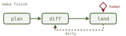
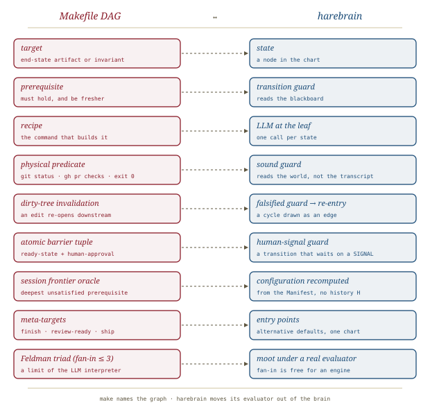

# Feldman's Makefile, *rebuilt*

*Cliff notes on Randal L. Schwartz's "Stuart Feldman Was Right in 1976: Why Your AI Agent Needs a Makefile, Not a 20-Step Prompt" (dev.to, October 2026), Part 3.6 of the* Synthetic Scars *series. A practitioner swaps the numbered checklist for a declarative dependency graph. That is half of the harebrain cage, written out in the prompt.*

---

## The checklist, and why it rots

Everyone starts the same way: a numbered SOP in a `SKILL.md`. *Step 1: pick an issue. Step 2: write a plan. Step 3: ask the human…* Seventeen steps later it reads like an intern's first-day handout. In production, Schwartz reports, it collapses. He names three failures:

- **Attentional degradation.** As compiler logs and diffs pile up, the top of the checklist slides tens of thousands of tokens into the past.
- **The imperative GOTO trap.** Real work loops: CI fails, a review bot comments. So the prompt author writes routing prose. *"If a review bot leaves comments after Step 9, jump to Step 12.2. If code edits are needed, go back to Step 5, but do not re-create the branch…"* The prompt now asks the model to simulate a virtual machine with nested loop counters across 150 tool turns. It loses its place, skips a gate, or invents an exit.
- **Resuming in the middle.** Wake the agent two hours later with *"CI failed on the widget test"* and it reads `Step 1: Pick an open issue` at the top of its skill file. It asks which ticket to work on, and the human is back to micro-managing: *"you're on Step 12, sub-step B."*

All three are one defect. **The checklist puts the instruction pointer inside the model**, and the model has nowhere reliable to keep it.

## The move: targets, prerequisites, recipes

Feldman's 1976 insight was that imperative build scripts fail because they ignore what depends on what. `make` has three nouns: the **target** (an artifact or a verified condition), its **prerequisites** (what must exist, and be fresher, first), and the **recipe** (the command that produces it). `make` has no step numbers, only the graph.

Schwartz's claim is that an agent's ticket workflow *is* such a graph, of software artifacts and verified invariants, and he writes it down:

```makefile
finish: land codified-scars-consolidated pristine-workbench
land: ready-to-land human-landing-approval
ready-to-land: ci-quiescent changelog-updated
ci-quiescent: push ci-remote-green all-bots-triaged
push: commit human-push-approval
commit: pre-commit-clean human-commit-approval
pre-commit-clean: approved-adversarial-report clean-static-analysis doc-audit-complete
approved-adversarial-report: adversarial-review triaged-blockers human-review-approval
adversarial-review: implementation-diff
implementation-diff: approved-plan tdd-failing-repro human-diff-approval
approved-plan: researched-ticket human-plan-approval
researched-ticket: ticket-assigned candidate-scars git-archaeology
```

Every dispatch has the same goal, `make finish`. Backward-chaining from there to the deepest unsatisfied leaf produces the trajectory without a step list.


*The article's two flowcharts, side by side. On the left the model must remember where it is. On the right the disk remembers for it.*

The loops go away too. Schwartz states the fixed point as

```text
Satisfied(target) ⇔ (∀ p ∈ Prerequisites: Satisfied(p)) ∧ Invariant(target)
```

When a bot finding forces a code edit, the working tree goes dirty, and that alone invalidates `commit`, `push`, and `approved-adversarial-report`. No prose rule says *"jump back to Step 5.2"*. The graph sends the agent back through the critic. The model has one question to ask: *which single leaf am I building, and does its invariant hold?*

## The Feldman Triad: a rule with a folk mechanism

The most original rule in the piece is the **Bounded Fan-In Invariant**: `1 ≤ |Prerequisites(target)| ≤ 3`. The rule factors every privileged human checkpoint into an **atomic barrier tuple** with exactly two prerequisites, a readiness target and the human gate: `land: ready-to-land human-landing-approval`.


*The "Prerequisite Dilution Trap" (`SCAR-PROC-91`) and its fix. After four mechanical checks pass in a row, the fifth item, the human gate, gets ticked as rhetoric instead of enforced as a barrier.*

The failure is plausible, and the fix is good engineering. Isolating the human gate as one of two prerequisites makes "stop" the only non-mechanical thing left to check. The *explanation*, though, is folk mechanism. Schwartz offers four reasons: attention to the tail of a list "decays sharply"; "autoregressive verification momentum" pushes the conditional probability of continuing "toward 1.0"; Miller's 7 ± 2 "compresses to 3 ± 1 in dense tool-calling contexts"; and a transformer has no integer register. The piece measures none of them. Miller's number describes human short-term memory, and the 3 ± 1 compression is uncited. The rule may well work for a simpler reason: a target with one readiness check and one human gate is easy to read and hard to rationalize past.

> **The tell.** The Feldman Triad works around a weakness of *the LLM as make interpreter*. GNU make evaluates fifty prerequisites as reliably as two. A fan-in limit signals that the wrong component is evaluating.

## Resume from the world, not the transcript

The strongest idea in the piece is the **Session Frontier Resolution Oracle**. The oracle never asks conversational memory where the agent is. It inspects the repository and the forge instead, and the deepest unsatisfied prerequisite *is* the current position:

| Physical git / forge state | Resolved target |
|---|---|
| PR open, unaddressed bot comments or red CI | `ci-quiescent` |
| PR open, checks green, bots quiet | `land` |
| Committed locally, not pushed | `push` |
| Implementation passing tests, unreviewed | `adversarial-review` |
| Approved `plan.md` on disk, no code yet | `implementation-diff` |
| Clean tree on `main` | `ticket-assigned` |

*"The filesystem and git graph are the state machine."* `make` keeps no current state; it *recomputes* its position every run from artifacts and timestamps, which is exactly why it survives interruption. A chart that stores its active configuration has to protect it; a graph that derives its configuration has nothing to lose. (Part 3.7, [[init-d-compaction]], hardens the same idea against context compaction.)

The meta-targets fit naturally: `make review-ready` stops at an open PR, `make ship` enters at `pre-commit-clean` for code a human already wrote, and `make fast-track` skips archaeology for doc fixes. They are alternative goals in one graph, not separate procedures.

## The evidence, read soberly

| Claim | What's offered | What's missing |
|---|---|---|
| Makefile DAG beats the checklist | 143 production tickets (101 open-source BlocSignal, 42 commercial monorepo) | No checklist baseline on comparable tickets. The comparison is before/after, by the same operator who wrote the workflow |
| 0.0 % repeat regression rate | Backed by "450 codified Synthetic Scars" | "Repeat regression" is defined elsewhere in the series ([[teaching-pain]]). The scar library and the Makefile are confounded |
| Zero-nudge autonomous runs | "Routinely" | No rate, no failure count, no model named in this part |
| It works because of pre-training gravity | Mechanism assertion | Tested later in [[pretraining-gravity]]: the Makefile suite came out *null* in aggregate (72.5 % vs 72.5 %), with a gain only on the smallest model tier (3.3 % → 20.0 %) |

The advice stands, but as a field report from one skilled operator, not a result. The scorecard is n = 1 practitioner, self-reported, with the treatment (the Makefile) bundled with an evolving scar library and a growing workflow gist.

## Where this sits in the harebrain hypothesis

The harebrain thesis is `harebrain = fast LLM brain × structured game-AI cage`. Part 3.6 is a practitioner arriving at the cage from the prompt side. The workflow is a declarative graph of guarded milestones, human gates are explicit edges, and position comes from world state rather than chat memory. That covers half of the harebrain move. The other half, *who runs the graph*, is where the two diverge.


*Same graph, different evaluator. GNU make's guarantees come from `make` the program; in Part 3.6, the LLM is asked to be `make`.*


*Make names the graph; harebrain moves its evaluator out of the brain.*

| Makefile DAG (Part 3.6) | harebrain |
|---|---|
| Target | State / milestone in the chart |
| Prerequisite | Transition guard reading the blackboard |
| Recipe | The LLM at the leaf — one call per state |
| Physical predicate (`git status`, `gh pr checks`, exit code) | Sound guard — reads the world, not the transcript |
| Dirty-tree invalidation | Falsified guard → transition back; the cycle drawn as an edge |
| Atomic barrier tuple (`ready + human-approval`) | A transition guarded on an external human SIGNAL |
| Session frontier oracle | Active configuration recomputed from the Manifest |
| Meta-targets (`finish`, `ship`, `fast-track`) | Alternative entry points into one chart |
| Feldman Triad (fan-in ≤ 3) | Moot when an engine evaluates the guards |

### What the piece gives harebrain

- **A field case for declarative over imperative.** Harebrain argues from game AI and Harel that agent control flow belongs in a structure, not prose. Part 3.6 reaches the same conclusion from 143 tickets of daily coding-agent use. It is the formal-medium counterpart to [[nlah]]'s prose harness, from the same direction.
- **Resume-from-world as a design rule.** The [MPLv2 notes](../../../mpl/mpl.md) record that MPLv2, unlike [[harel]]'s statecharts, has no history entrance (`H` / `H*`) and would have to emulate it with `vars`. The frontier oracle suggests a better answer for long-running agent work. If every guard reads external artifacts, the runtime can rebuild the active configuration from the Manifest, so nothing needs remembering. History becomes an optimization, not a recovery mechanism.
- **The human airlock as a pattern.** Give the human gate a dedicated transition, with exactly one readiness guard beside it. That is a clean, reusable shape for human-in-the-loop edges in a chart.
- **"Physically unsatisfied" as the soundness test.** `self_critical_review.md` must exist on disk with `VERDICT: APPROVED (0 BLOCKERS)`. That is the [[expectation-driven-development]] executed-vs-narrated distinction applied to workflow gates: a gate that reads an artifact can be sound, and a gate that reads the conversation cannot.

### What harebrain pushes that the piece doesn't

- **Take the evaluator out of the model.** In Part 3.6 the constrained agent still runs, reads, and acts on every "physical" check. The agent writes `self_critical_review.md`, the agent checks that it exists, and the agent decides `STOP (tool_calls: [])`. Nothing stops a confident model from running `gh pr merge` anyway. Harebrain's runtime ticks the chart, evaluates the guards, and calls the LLM only for the recipe. Then the Feldman Triad, the single-active-target rule, and the attention arguments all stop mattering, because the brain never holds the instruction pointer.
- **A DAG is the wrong shape for reactive work.** `make` is transformational: build once, terminate. A ticket is reactive, and Harel's 1987 paper opens on that distinction. The agent waits on CI, on bots, and on humans, and loops when they object. Part 3.6 patches reactivity in through invalidation and re-evaluation. `ci-quiescent` is a *waiting state* dressed as a build target, and the bot-remediation loop is a *cycle* smuggled into an acyclic graph via timestamps. A statechart has waiting states, events, cycles, and orthogonal regions (CI running ∥ bot triage ∥ changelog) natively. The Makefile is the right *teaching* formalism; the statechart is the right *executing* one.

> **The trap to mark.** A Makefile in a prompt is a dependency graph the brain is *asked to honor*, not one a runtime *enforces*. Its syntax is a much better request than a checklist, and Schwartz's tickets suggest it is honored far more often. But "honored often" is not a guarantee. A harebrain workflow that ships its chart as prompt text has rebuilt Part 3.6, and inherited its soundness story: none.

## What's worth taking away

- Replace numbered checklists with targets and prerequisites. Workflows are graphs of verified artifacts, and step numbers encode the graph in a form the model must keep decoding.
- Derive position from the world. A frontier recomputed from disk and forge state survives interruption, compaction, and handoff, and a remembered step number survives none of them. This is the piece's most transferable idea, and it points at how harebrain should handle resumption without history connectors.
- Give every human gate its own two-prerequisite target. The pattern is sound even though its attention-decay explanation is unproven.
- Read the evidence as one expert's field report. There is no baseline, the treatment is confounded with a scar library, and the series' own later benchmark found the Makefile effect null in aggregate.
- The harebrain step Part 3.6 stops short of is running the graph in an engine, with the LLM as the recipe. That one change turns every "the model should stop here" into "the model cannot proceed from here".

---

**Sources.** Schwartz, R. L. "Stuart Feldman Was Right in 1976: Why Your AI Agent Needs a Makefile, Not a 20-Step Prompt." *DEV Community* (GDE organization), 9 October 2026. Part 3.6 of the *Synthetic Scars* series. [dev.to/gde/stuart-feldman-was-right-in-1976-…-5bn2](https://dev.to/gde/stuart-feldman-was-right-in-1976-why-your-ai-agent-needs-a-makefile-not-a-20-step-prompt-5bn2). Companion workflow: [Randal's public workflow gist](https://gist.github.com/RandalSchwartz/598a1f2b5760a23c1d70b57e9e85393f). Background: Feldman, S. I. "Make — A Program for Maintaining Computer Programs." *Software: Practice and Experience* 9(4), 1979. Series overview: [[synthetic-scars]]. Companion harebrain summaries: [[harel]] (reactive vs transformational; the missing history entrance), [[init-d-compaction]] (Part 3.7), [[pretraining-gravity]] (Part 3.8, where the Makefile suite was benchmarked), [[expectation-driven-development]] (executed vs narrated evidence). All diagrams above are original SVGs drawn for this page.
