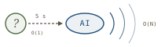
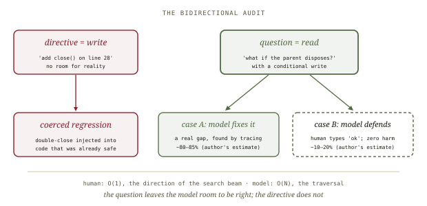
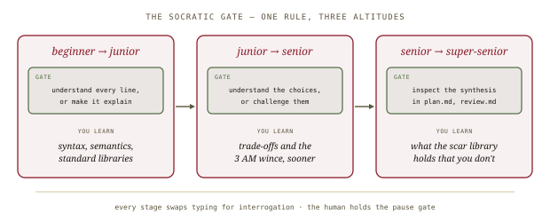
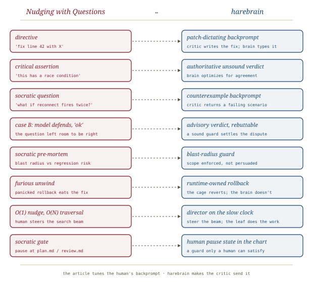

# Nudging with Questions, *nudged*

*Cliff notes on Randal L. Schwartz's "Nudging with Questions: Why Telling Your AI What to Fix Triggers an Apology Death Spiral (And How to Advance Juniors)" (dev.to, 3 October 2026), Part 3.5 of the* Synthetic Scars *series. It is a mentoring essay about the grammatical shape of a correction. For harebrain the point is what a critic should send back to the brain: a failing scenario, not a patch.*

---

## The claim

Part 3.5 is the series' practical interlude. [[socratic-prompting]] (Part 3) laid out the theory. This part is the workbench version, built from forty years of mentoring juniors and a LinkedIn comment from a reader, Mark Hedges, who named the failure mode: **the insecure neurosis death spiral.**

> **The one-line claim.** Don't tell the agent what to fix; ask it a question whose answer *is* the bug. A directive gets compliance, a criticism gets sycophantic panic, and only an open question makes the model trace the execution and find the collision itself.

The opening scene will be familiar to anyone who has paired with a coding agent. You spot a hazard and say *"Change line 42 to cancel the stream subscription."* The model grovels (*"You are entirely right! I apologize…"*), patches line 42 and crashes the isolate on unmount. You bark again. It wraps the function in three layers of `try-catch`. Four turns in, the context is full of apologies and you are doing all the reasoning yourself. Schwartz calls this role the **Human Compiler**.

## Two working models, redrawn

The essay replaces one mental model with another. Prompt tricks treat the model like a vending machine that pays out if you jiggle it right. Schwartz's working model is **an eager, brilliant, slightly neurotic junior developer at the workbench.** It was trained on human pedagogical dialogue, so it reacts to correction the way a three-week hire does.

*The boss model is a cycle; the mentor model is a line. The labels in the boxes ("forced causal simulation") are the author's description of the mechanism, not a measurement of it.*

The essay sorts corrections into three modes. The table is the core of the piece:

| Mode | What you say | What the model does (per the author) | Outcome |
|---|---|---|---|
| **Directive** | *"Change line 42 to cancel `_sub`."* | Mechanical token substitution; no search | Band-aid that breaks on the next lifecycle transition |
| **Critical statement** | *"This code has a race condition on reconnect."* | Sycophantic compliance; optimizes for agreement | The neurosis spiral: apologies, defensive bloat, broken invariants |
| **Socratic question** | *"What happens to `_sub` if the network reconnects twice in 50 ms?"* | Must forward-simulate to produce the next token | The model finds the collision and fixes it cleanly |

The argued mechanism is **the open variable.** An assertion is a constraint the model can satisfy by agreeing. A question has an unbound slot that the model can only fill by tracing the timeline: reconnect 1 creates a listener, the HTTP call starts, reconnect 2 overwrites the variable, call 1 returns into an abandoned listener, *collision.* The discovery belongs to the model, so the fix is architectural rather than local. The author calls it *"Inception for neural networks."*

## The bidirectional audit: a question is a read

The sharpest idea in the piece is an asymmetry that most prompting advice misses. A directive can *inject* a regression. The model obeys *"Change line 28 to close the stream controller"* even when a parent scope already disposes the controller, and turns code that was fine into a double-close. A question cannot do that.

*"A question is a read operation with a conditional write." The 80–85 / 10–20 split is the author's estimate, given without counts.*

When the model is right and you were wrong (Case B), it explains why the code is already safe. You type *"ok"*: two seconds, zero regressions. Sometimes it teaches you a language feature you hadn't seen. *"When you prompt with commands, the AI is trapped inside the ceiling of your own current knowledge."*

The same move handles **scope creep**. Hedges appends a **Socratic pre-mortem** to every planning prompt: *"If you stay narrowly focused on this solution only, and ignore other problems that you might find along the way, will regressions be less likely to be introduced by a focused, small change?"* The alternative is to say *"DO NOT TOUCH OTHER CODE"* and then shout when the diff covers twelve files. That shout triggers the **furious unwind**, a panicked rollback that reverts the fix you wanted and leaves orphaned imports behind. The author explains why the negative instruction fails with his **Pink Elephant** argument (naming "other code" pulls attention toward it), which [[pretraining-gravity]] develops further.

## The economics: O(1) human, O(N) machine

*The essay's answer to "how do juniors learn now?". The same interrogation discipline applies at every rung, and at the top the scar library teaches the person who wrote it.*

The Human Compiler spends three minutes engineering a patch in their head and typing out a paragraph for the agent to transcribe. The Socratic senior turns a gut *wince* into a five-second question and lets the model do the traversal. The human contributes the *direction of the search beam*, O(1); the machine pays for the search, O(N). When the first answer lands in a local minimum, the human asks a second five-second question and still leaves the keyboard alone.

The second half of the essay applies this to the **junior crisis**. Its answer is the **Socratic Gate**, a single rule applied at rising altitude. A beginner may use AI freely *if* they understand every line or make the agent explain it. A junior may let the AI write features and tests *if* they understand the design choices or challenge them before the PR. At the top, the human reads `plan.md` and `review.md` at the pause gates, and the 400-scar library teaches its own author. Schwartz cites Bloom's 2-sigma tutoring result for the economics: an explanation in place against your own repository at this commit beats a generic tutorial many times over.

## Reading the evidence honestly

The piece is a strong practitioner essay and a weak empirical one. The weaknesses matter because the headline number travels.

- **"95% or more of the time, the result is good on the very first try."** It comes with no denominator, no task set, no definition of "good" and no control arm. It is one expert's field impression of his own sessions. The 80–85 / 10–20 split between Case A and Case B is presented the same way.
- **The mechanism is a metaphor.** "Attention heads must forward-simulate the scenario" and "the discovery is native" describe the experience well, but nothing in the piece measures them. Treat them as the author's working model, not as an account of how transformers work.
- **The question carries more information than the directive.** Every entry on the cheat sheet does the same thing. *"What happens if two buttons trigger this within 5 ms?"* is a **concrete failing scenario**, which is a test case. *"Add a lock"* is a fix with the scenario removed. Some of the effect that the essay credits to the question mark may come from the counterexample. The essay never separates the two, and harebrain cares about the difference (see below).
- **The pre-mortem works by agreement.** *"…will regressions be less likely…?"* is a leading yes/no question with an obvious answer. It works because the model *agrees* with the human, which is the same pull the essay blames for the death spiral. The technique is real, but its explanation is inconsistent: "questions defeat compliance" turns out to mean "well-chosen questions get compliance aimed at the right target".
- **Questions can pull a correct model off its answer too.** The sycophancy literature (e.g. Sharma et al., *Towards Understanding Sycophancy in Language Models*, 2023) reports that a challenge like *"are you sure?"* can make a model drop a correct answer. Case B shows the model can hold its ground, but the essay never measures how often a Socratic nudge leads the model to "find" a bug that isn't there.

> **The defensible core.** Strip away the physics vocabulary and one claim survives, and it is a good one: *a correction should hand the model a failing scenario and leave it room to disagree, not hand it a patch and demand compliance.* Every rival framing in the essay is compatible with that sentence.

## Where this sits in the harebrain hypothesis

The harebrain thesis is `harebrain = fast LLM brain × structured game-AI cage`. Read through that lens, Part 3.5 is about the backprompt channel. In [[llm-modulo]]'s vocabulary, the human in this essay acts as a soft critic plus a meta-controller. They read the brain's output, judge it, and write the next prompt. The essay is a style guide for that **backprompt**, and its finding is that the shape of the critique matters as much as its content.

*The article tunes the human's backprompt. Harebrain makes the critic send it, on every transition.*

| Nudging with Questions | harebrain |
|---|---|
| Directive (*"fix line 42 with X"*) | Patch-dictating backprompt: the critic writes the fix, the brain transcribes it |
| Critical assertion | Authoritative unsound verdict: the brain optimizes for agreement, not truth |
| Socratic question | **Counterexample backprompt**: the critic returns a failing scenario |
| Case B: model defends, human says *"ok"* | Advisory verdict, rebuttable, with a sound guard to settle the dispute |
| Socratic pre-mortem (blast radius) | Blast-radius guard / utility curve: scope enforced, not persuaded |
| Furious unwind | Runtime-owned rollback: the cage reverts, not the brain |
| O(1) nudge, O(N) traversal | Director on the slow clock steering the beam; the leaf does the work |
| Socratic Gate (`plan.md`, `review.md`) | Human pause state in the chart: a guard only a human can satisfy |

### What the piece gives harebrain

- **A format rule for critic output.** Harebrain has specified its critic bank by *what* it checks, not by *how* its verdict re-enters the brain. The essay supplies the rule: a backprompt should carry the failing scenario (inputs, interleaving, timing), not the remedy. This is what [[llm-modulo]]'s critics already do when they return a counterexample ("here is the step that violates the precondition"). It is also the shape of [[expectation-driven-development]]'s challenge (*"you never showed what happens with two discount codes"*). Three sources now converge on the same shape for a critique.
- **The bidirectional audit as a guard property.** A directive is a write the brain can't refuse. A question is a read that the brain may answer with "already handled, here's why". Harebrain should let the leaf **rebut** an advisory verdict and route on the rebuttal instead of forcing a patch. If the rebuttal cites line 14's auto-dispose binding, a sound guard (a test, a type check) can confirm it. That removes the coerced-regression failure by construction.
- **Blast radius as a named axis.** The pre-mortem and the author's mandatory "Blast Radius" review pillar both treat diff scope as a first-class risk signal. Harebrain's utility-scorer sketch already lists blast radius as a scoring curve. The essay is practitioner evidence that it belongs there.
- **The human pause gate as a teaching surface.** The Stage 3 observation is that a pause at `plan.md` upskills the reviewer. So harebrain's human-in-the-loop states are more than checkpoints: they are where the cage's accumulated knowledge reaches a person. The artifacts a pause state shows should be written to be read.

### What harebrain pushes that the piece doesn't

- **Make the nudge structural.** The essay's nudge depends on a 40-year *wince* that juniors don't have. That is a single point of failure, and the Socratic Gate admits as much. Harebrain's move is to take the wince out of the human. An adversarial soft critic generates "what happens if…" probes at each transition, and a sound guard (a test of the generated scenario) decides whether the brain's answer holds. The human's five seconds become the critic's job on every tick.
- **Enforce scope; don't persuade.** The pre-mortem *talks* the model into a small diff, and it works most of the time. A cage puts a guard on the diff (files touched, call-sites affected) and rejects the transition when the guard fails. Persuasion is the rung below enforcement. [[pretraining-gravity]]'s data puts numbers on that gap for other primitives.
- **Rollback belongs to the runtime.** The furious unwind exists because the brain owns its own undo. If the runtime holds the checkpoint, *"revert"* is a state transition, not a panicked generation. The model never gets a chance to destroy the fix while apologizing.

> **The trap to mark.** A Socratic critic is still a critic that the brain can agree with too easily. If every backprompt in a harebrain workflow is a well-phrased question and no sound guard checks the answer, you have only made the sycophancy more polite. The question earns its value only when something outside the brain can run the scenario it names.

## What's worth taking away

- The claim worth keeping is not "use question marks". It is **critique with a failing scenario, and leave room to be wrong.** Harebrain should adopt that as the output contract for soft critics: counterexample in, remedy left to the brain.
- The directive/question asymmetry (write vs read-with-conditional-write) is the right model for *who is allowed to be right* at a transition. A harebrain leaf should be able to rebut an advisory verdict, and a sound guard should settle the dispute.
- Scope creep and the furious unwind are cage problems wearing prompt clothing. A diff-size guard and runtime-owned rollback remove both without any phrasing.
- The headline numbers (95%+ first pass, the 80–85 / 10–20 split) are one practitioner's impressions with no denominator. Cite the essay for the *technique* and the *taxonomy*, not as evidence of an effect size.
- Part 3.5 is the hinge of the series. Parts 1–3 are about what the human knows ([[teaching-pain]], [[happy-path-mirage]], [[socratic-prompting]]). From [[makefile-not-checklist]] onward, the series moves that knowledge into structure the agent cannot talk its way around. See [[synthetic-scars]] for the arc.

---

**Sources.** Schwartz, R. L. "Nudging with Questions: Why Telling Your AI What to Fix Triggers an Apology Death Spiral (And How to Advance Juniors)." *DEV Community* (Google Developer Experts organization), 3 October 2026. Part 3.5 of the *Synthetic Scars* series. [dev.to/gde/nudging-with-questions-…-5gm4](https://dev.to/gde/nudging-with-questions-why-telling-your-ai-what-to-fix-triggers-an-apology-death-spiral-and-how-5gm4). Reader comments quoted within are from Mark Hedges (LinkedIn), as reported by the author. Background cited in this summary: Sharma, M. et al., "Towards Understanding Sycophancy in Language Models" (arXiv:2310.13548, 2023); Bloom, B. S., "The 2 Sigma Problem" (*Educational Researcher*, 1984). Companion harebrain summaries: [[synthetic-scars]] (series overview), [[socratic-prompting]] (Part 3, the theory this part applies), [[pretraining-gravity]] (Part 3.8), [[llm-modulo]] (the backprompt loop), [[expectation-driven-development]] (adversarial challenge of evidence). All diagrams above are original SVGs drawn for this page.
