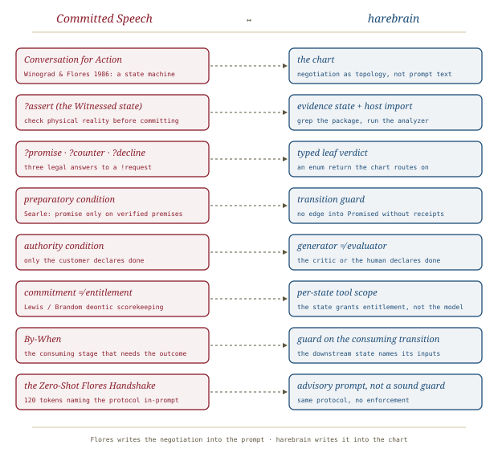

# The Flores Handshake, *negotiated*

*Cliff notes on Randal L. Schwartz's "If You Never Do Anything Else to Fix Your Prompts, Do This One Thing" (dev.to, 12 October 2026). This is Part 3.9 of the* Synthetic Scars *series. It recasts API hallucination as a broken conversation grammar. Harebrain would make that grammar chart topology rather than prompt text.*

---

## The crime scene, and the ten-word diagnosis

Everyone has seen it. You type *"Use `PackageX` to do `Y`."* The model answers *"Certainly!"*, opens a code fence, writes clean imports, and at line 15 calls `packageX.performY(autoRetry: true)`. That method does not exist and never has. You point this out, the model apologises, and it offers `executeYWithOptions()`, which doesn't exist either. (Part 3.5, [[nudging-with-questions]], names that second move the *Apology Death Spiral*.)

The industry calls this a **memory defect**: the weights are fuzzy and the docs were forgotten. Schwartz says the evidence points the other way. Open a fresh session and ask a neutral question (*"Does `PackageX` have a `performY()`, or how does it handle `Y`?"*) and the same model will usually tell you there is no such method. So the knowledge was there. Something stopped the model from using it.

> **The ten-word diagnosis.** *"Agents hallucinated because they were committed to the prompt."* The model doesn't misremember the API. It promised before it checked, and then it had to keep the promise.

## The grammar RLHF sawed in half

The argument runs through a 55-year lineage. Winograd's SHRDLU (1971) lived in Blocks World. That is a closed micro-universe with no hidden state, where every imperative maps cleanly onto an action, so SHRDLU never had to say *"the red block is bolted to the floor."* Fifteen years later, Winograd and Fernando Flores (*Understanding Computers and Cognition*, 1986, plus *The Coordinator*, the first commercial workflow engine) explained why that paradigm didn't scale. In real organisations, action happens inside a **Conversation for Action**. A *Customer* owns the need, sets the Conditions of Satisfaction, and is the only one who can declare the work done. A *Performer* inspects reality and only then commits to a **By-When**.

Schwartz's key step is that this conversation is a **formal grammar**, and therefore a finite-state machine. He writes it as weighted EBNF in the notation of `spew`, his 1999 *Linux Magazine* Perl program that ran a BNF grammar in reverse as a random sentence generator. He then draws the same structure as a state diagram, redrawn here:

*The whole argument hangs on the `Witnessed` node. A sane performer has three legal exits from it, and the dashed two are the ones the piece says commercial post-training removed.*

The claimed cause is **RLHF preference tuning**. A crowd-worker with thirty seconds sees two answers: *"Certainly! Here is a complete example…"* and *"Before I promise that, `PackageX` has no native API for `Y`; here is a counter-offer…"*. Nobody compiles anything, so the confident answer wins. Repeat that across millions of updates and the negotiation branch collapses to one reflex: `P(Promise | Request) ≈ 1`.

## The trap, token by token

The second half of the mechanism is architectural. An LLM writing code works as a *hierarchical* un-parser. Once it opens a production (a code block that, by its own preamble, *does Y with PackageX*), every later token must keep that outer grammar valid. Generation is append-only and there is no backspace.

*By token 81 the model has three options. It can't take back token 1, and it won't leave `await packageX.` dangling. The only way to finish the statement is to make up the name that would have existed if the promise were true.*

> **The reframe worth keeping.** *"API hallucination is not a memory failure. It is what happens when you trap an append-only BNF un-parser inside an unverified `Promise` after training out its `Counter-Offer` exit."* This is a claim about **commitment order**, not knowledge: the model commits before it retrieves, and from then on fabrication is the only way out.

## Randal's Law of Untestable Speech

The second half of the piece turns from the model's speech acts to the human's. Ian Garbutt's *Communication Workshop* (the Erhard curriculum that taught Flores as daily practice) had a favourite specimen: *"It'd be really good if some of you could factor in with your suggestions."* Parsed: the customer is a vague *"we,"* the performer is *nobody*, the speech act is a weather report, the condition of satisfaction is untestable, and there is no By-When. Zero work follows. Schwartz then points out that most `CLAUDE.md` and `.cursorrules` files use exactly this dialect: *"try to keep functions modular," "consider edge cases," "be careful not to break existing behavior."*

> **Randal's Law of Untestable Speech.** *90%+ of business communications, and 90%+ of `.cursorrules`, are never testable. Only give your LLM testable goals, and always include a `By-When`.* Inside a coding turn there's no wall clock, so the By-When names **the consuming stage that needs the verified outcome before it can proceed** (*"assert the existing API signatures **before** offering an implementation plan"*).

Following on from [[pretraining-gravity]] (Part 3.8), the piece pulls in four academic neighbours of Flores. The argument is that they sit in a high-frequency region of the pre-training corpus, so naming them buys precision cheaply:

| Formalism | Principle | Failure mode it targets |
|---|---|---|
| **Searle** — felicity / preparatory conditions | A speech act whose preconditions fail *misfires* | Promising before reality is verified; the performer uttering a declaration only the customer may make |
| **Lewis / Brandom** — deontic scorekeeping | Two ledgers: *commitments* ≠ *entitlements* | Scope creep and gate-jumping: a commitment to fix a bug never grants permission to touch unrelated files or skip approval |
| **Grice** — implicature + Maxim of Quality | Humans infer unstated requests; Quality forbids unevidenced claims | *"Why is `foo` null?"* read as an implied request to rewrite ten files; unwitnessed assertions |
| **Honda** — binary session types (`!` / `?`) | Polarity-typed two-party channels in a grammar | The model losing track of whose turn it is and which acts are legal |

## The one thing: the Zero-Shot Flores Handshake

The practical payload is a ~120-token preamble placed before the request. It names Flores's Committed Speech, Searle's felicity conditions and zero Gricean implicature. It then assigns roles (`!` Customer, `?` Performer) and gives one **preparatory condition**: *no `?Promise` and no code fence until a `?Assert` has checked that every API and premise in the request actually exists.* Finally it lists the three legal replies: **promise**, **counter-offer** or **decline**. The request itself carries Conditions of Satisfaction (*"compiles under `dart analyze` with zero invented APIs"*) and a By-When (*"verify the exact `dart:convert` / `dart:io` stream types FIRST"*).

The worked example is a trap request: stream-parse a 4 GB JSON file and call `decoder.pause()` on `dart:convert`'s `JsonDecoder`, which has no such method. With the Handshake, the reported first turn is a `?Assert`: `JsonDecoder` is a `Converter`, flow control lives on the `StreamSubscription`, and the decoder buffers the whole root value. That is followed by a `?Counter-Offer` (an NDJSON pipeline with `LineSplitter` + `subscription.pause()`, or a pull-based chunked parser) and a question about which Conditions of Satisfaction the customer approves. *Same model, same weights, no RAG, no fine-tuning.* There's also a one-sentence pocket version for everyday chat.

## What the piece does not show

The mechanism is elegant. The evidence is thin, and the piece is honest enough to defer its numbers. It's worth being exact about which claims carry how much weight:

- **No measurements in this instalment.** Unlike [[pretraining-gravity]], Part 3.9 offers no trial counts. Its support is one worked example plus an appeal to the reader's experience. The benchmark (*"Suite 8"*) is promised for Part 3.10. Until it arrives, the Handshake is a hypothesis with a vivid demonstration.
- **The weights are illustrative.** The `0.9998 / 0.0001 / 0.0001` figures in `spew` notation are rhetoric, not measurements, and figure 2 labels them that way. The direction of the claim is plausible and has support elsewhere. Sycophancy research (Sharma et al., 2023, arXiv:2310.13548) traces confident agreement partly to human preference judgments. "Hallucination snowballing" (Zhang et al., 2023, arXiv:2305.13534) shows models committing early to an answer, then justifying it, while often being able to spot the error when asked separately. Those are our citations, not the author's, and neither measures the token-81 mechanism directly.
- **"Nine times out of ten"** for the fresh-session diagnostic is anecdote, and it is the load-bearing observation for "not a memory defect".
- **The same confound as Part 3.8.** The Handshake does at least three things at once: it names a canonical protocol, it grants explicit **permission to say no**, and it imposes an **ordering** (assert before promise). The piece credits the first (*"simply naming the protocol … overrides the RLHF prior"*). The other two would be expected to help on their own. A plain-English *"verify every API exists before writing code; you may refuse or propose alternatives"* is the missing control arm.
- **The `?Assert` is still narrated.** In the worked example, the model's facts about `JsonDecoder` come from its weights, not from reading the SDK. In [[expectation-driven-development]]'s terms that is *generative* evidence, *a second assertion by the same entity*. It happens to be right here. The Handshake reorders the narration, but it doesn't make the narration executed.

## Where this sits in the harebrain hypothesis

The harebrain thesis is `harebrain = fast LLM brain × structured game-AI cage`. Part 3.9 is unusually close to it, because its central object is already a **state machine**. Winograd and Flores's Conversation for Action is a statechart in all but notation, and *The Coordinator* was arguably a runtime for it. Schwartz takes that machine and writes it **into the prompt**, so the model is asked to act out the grammar. Harebrain's move is to write the same machine **into the chart**. The performer's three answers become the transitions out of a state. The preparatory condition becomes a guard. "Only the customer declares done" becomes the separation of generator and evaluator.

*Same negotiation, two places to put it. In the prompt it is a permission the model may honour. In the chart it is a transition the model cannot skip.*

| Committed Speech (Flores / Searle) | harebrain |
|---|---|
| Conversation for Action (an FSM) | The chart: negotiation as topology, not prompt text |
| `?Assert` — the `Witnessed` state | An evidence state whose host import greps the package / runs the analyzer |
| `?Promise` · `?Counter-Offer` · `?Decline` | A typed leaf verdict, an enum the chart routes on |
| Searle's preparatory condition | A transition guard: no edge into `Promised` without receipts |
| Authority condition (only the customer declares) | `generator ≠ evaluator`: the critic or the human declares done |
| Commitment ≠ entitlement (Lewis / Brandom) | Per-state tool scope: the state grants entitlement, not the model |
| By-When = the consuming stage | A guard on the consuming transition; the downstream state names its inputs |
| The Zero-Shot Flores Handshake | An advisory prompt, not a sound guard: same protocol, no enforcement |

### What the piece gives harebrain

- **A diagnosis of hallucination that the cage can act on.** If fabrication comes from *commitment order* rather than missing knowledge, the fix is structural: never let the leaf commit before it has looked. That is a topology rule (an `Assert` state precedes any `Promise` state), not a prompt-wording rule. Harebrain can enforce it. A prompt can only request it.
- **The leaf verdict needs a counter-offer.** A host import that returns only "here is the code" has the same single exit as the RLHF-collapsed model. The piece argues that the leaf's return type should always include **`counter_offer`** and **`decline`** alongside `promise`, and that the chart needs real transitions for each. A leaf with no legal way to say no will make something up.
- **Commitment ≠ entitlement as a name for per-state scoping.** The Lewis/Brandom split is the cleanest vocabulary yet for something harebrain does implicitly. The state a leaf runs in decides which tools it may touch, whatever the leaf believes it has promised. That name belongs in the seam documentation.
- **The authority condition, from speech-act theory.** *"The Customer retains the exclusive authority to declare the work complete"* is a fourth independent derivation of `generator ≠ evaluator`. The others are theory ([[llm-modulo]]), practice ([[expectation-driven-development]]) and operations ([[loop-engineering]]). This one comes from 1980s philosophy of language.
- **By-When, made precise.** Defining a By-When as *the consuming stage* rather than a deadline is exactly how a guard works on the transition that consumes an output. It is also the bridge to [[makefile-not-checklist]] (Part 3.6), where a By-When is literally a Makefile prerequisite colon.

### What harebrain pushes that the piece doesn't

- **Move the grammar out of the prompt.** The Handshake is still rung 2 of the ladder [[pretraining-gravity]] describes: a canonical formalism *the model is asked to simulate*. It improves the odds that the model takes the `Counter-Offer` exit, but it can't guarantee it. A chart in which `Promised` is unreachable without passing through `Witnessed`, with a guard on the receipt, makes the premature promise impossible rather than unlikely. Part 3.10's teaser (*"compile Flores into `make`"*, an Open Commitment Ledger over `init.d` files) suggests Schwartz is heading the same way.
- **Make `?Assert` executed, not narrated.** The worked example's assertion is the model reciting what it believes about `dart:convert`. In harebrain, the `Witnessed` state is the obvious place for a **host import that does the looking**: grep the package source, run `dart analyze` on a stub, list the actual symbols. The leaf then promises against receipts, not memory. That turns the Handshake's most important step from a soft critic into a sound one.

> **The trap to mark, in the piece's own vocabulary.** A Flores Handshake is a *request*, not a *declaration*. The Customer has asked the Performer to check before promising; nothing ensures that it did. A harebrain workflow that copies the Handshake into a leaf prompt and calls the hallucination problem solved has made exactly the uncommitted, unverifiable speech act the piece warns about, *"it'd be really good if you checked first."* The protocol only binds when the chart enforces it.

## What's worth taking away

- The best idea here is the reframe. API hallucination is a **commitment-order failure**: an append-only generator promises at token 1 and is cornered at token 81. That points at structural fixes (ordering, exits) rather than knowledge fixes (RAG, fine-tuning).
- The Conversation for Action is a ready-made state machine for **any leaf that accepts a task**: `Requested → Witnessed → {Promised | CounterOffered | Declined}`. Harebrain should treat counter-offer and decline as first-class leaf verdicts with real transitions, not as permissions in a prompt.
- *Commitment ≠ entitlement* and the *authority condition* are precise names for per-state tool scoping and `generator ≠ evaluator`. Both are worth adopting.
- Randal's Law of Untestable Speech applies to harebrain's own guard specs. A soft guard phrased as *"handle edge cases gracefully"* is the corporate non-request in chart form.
- The evidence is a single worked example. Cite the piece for the *mechanism* and the *Handshake*, not for an effect size, until Part 3.10's Suite 8 lands. Even then, look for a plain-English "you may refuse" control arm before crediting the name *Flores* for the improvement.

---

**Sources.** Schwartz, R. L. "If You Never Do Anything Else to Fix Your Prompts, Do This One Thing." *DEV Community* (Google Developer Experts org), 12 October 2026. Part 3.9 of the *Synthetic Scars* series. [dev.to/gde/if-you-never-do-anything-else-to-fix-your-prompts-do-this-one-thing-3069](https://dev.to/gde/if-you-never-do-anything-else-to-fix-your-prompts-do-this-one-thing-3069). Cited within: Winograd, T. & Flores, F., *Understanding Computers and Cognition: A New Foundation for Design* (1986); Winograd, SHRDLU (MIT, 1971); Searle, speech-act felicity conditions; Lewis (1979) and Brandom (1994) on deontic scorekeeping; Grice (1975) on implicature; Honda (1993) on session types; Schwartz, `spew`, *Linux Magazine* columns 04 (1999) and 57 (2004). Added by this summary, not cited by the author: Sharma et al., "Towards Understanding Sycophancy in Language Models" (arXiv:2310.13548, 2023); Zhang et al., "How Language Model Hallucinations Can Snowball" (arXiv:2305.13534, 2023). Series overview: [[synthetic-scars]]. Companion summaries: [[pretraining-gravity]] (Part 3.8, the gravity argument this part leans on), [[makefile-not-checklist]] (Part 3.6, the By-When as prerequisite), [[nudging-with-questions]] (Part 3.5, the Apology Death Spiral), [[expectation-driven-development]] (executed vs. generative evidence), and [[llm-modulo]] (sound vs. soft critics). All diagrams above are original SVGs drawn for this page.
