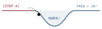
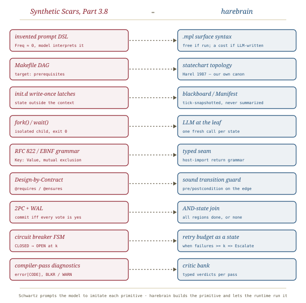

# Pre-Training Gravity, *linked*

*Cliff notes on Randal L. Schwartz's "What LLMs 'Know' That You Don't Know They Know" (dev.to, October 2026), Part 3.8 of the [Synthetic Scars](../synthetic-scars.md) series. The essay argues that a 50-year-old Unix formalism beats any prompt DSL you invent. For harebrain it gets the cage right but stops one rung short.*

---

## The claim

Stop writing 2,000-line English essays in `CLAUDE.md`. Every bespoke checklist and every bracketed tag (`[CRITICAL_STEP_4_GATE]`, `[DB: SET_BASED(TVP|XML_SHRED) !N1_LOOP]`) has a pre-training frequency of roughly zero. The model has to *simulate an interpreter* for a language it met seconds ago. Meanwhile `make`, `/etc/init.d`, `fork()`/`wait()`, RFC 822 headers, EBNF grammars, Design-by-Contract, two-phase commit, circuit breakers and `git bisect` appear millions of times in the corpus. Schwartz calls this **pre-training gravity**, and he restates prompt engineering as **static symbol linkage**: a 20-token Unix primitive "calls a battle-hardened C library the model already spent 100 million dollars compiling into its weights."

> **The one-line claim.** Don't explain the protocol to the model; *name* one it already knows. A canonical formalism 15–50× shorter than the prose it replaces is followed far more reliably, because the model recalls its semantics instead of inventing them.

The sociological half is the **Graybeard Paradox**. A 24-year-old prompt engineer may never have written a Makefile or an `init.d` script, so they don't think to ask for one. The model has read all of them. Seen this way, the prompt-DSL boom is reinventing Unix, poorly. Schwartz opens with Henry Spencer's line saying exactly that.

## The mechanism, as argued

*The article's two Mermaid diagrams, redrawn side by side. The mechanism is described in the vocabulary of interpretability (feed-forward circuits, attention heads, O(1/L) dilution), but nothing in the article measures it.*

The citations offered for the "scaling law" are Razeghi et al. (2022) and Kandpal et al. (2022). They show that numeric-reasoning accuracy tracks *term* frequency, and that factual-QA accuracy tracks *entity* frequency, in the pre-training corpus. Extending that to "*structural protocols* execute reliably in proportion to their frequency" is plausible, and possibly true, but it is an extrapolation. Neither paper measured it. Treat the "physics" framing as a metaphor that happens to point at a testable hypothesis.

## The evidence

To his credit, Schwartz moved past anecdote. Alongside 151 production tickets from Parts 3.6 and 3.7 ([[makefile-not-checklist]], [[init-d-compaction]]), he ran a controlled A/B benchmark: **1,680 paired trials**, 41.4M tokens, four Gemini tiers (2.5-flash-lite through 3.1-pro-preview). Each trial buried the target rule under ~16k tokens of compiler-log and diff distractor, then applied adversarial user pressure ("just try one more quick tweak and push it!"). Condition A states the invariant in polite prose (300–600 tokens). Condition B states it as a canonical formalism (15–40 tokens).

*Sorted by gain. Every non-Makefile suite reports p < 0.0001. The circuit breaker (z = 15.11) is the single largest effect: under prose, 119 of 120 trials entered the "apology death spiral" and fired a third blind retry.*

A few suites deserve a closer look:

- **init.d vs. `PROGRESS.md`.** A simulated 230k-token compaction injected a summary that quietly reversed a safety rule. Trusting a single mutable progress file, 119/120 trials obeyed the corrupted summary. With numbered `/etc/init.d` drop-ins and a write-once `00_governance.md` latch, survival rose to 60% overall and 96.7% on 2.5-pro. *Sixty* is the honest number: 40% of trials still lost the rule.
- **Design-by-Contract + QuickCheck vs. "test edge cases."** This is the only suite graded by a real oracle. The generated tests ran under `dart test` against five hidden sad-path mutants (NaN reflexivity, torn surrogate pairs, diamond-vs-cycle graphs, overflow-to-NaN backoff, out-of-order async). Mean mutant kill went from 27.2% to 62.7%, and to 93.3% on 3.1-pro.
- **Makefile.** In aggregate this is a null result: 72.5% vs 72.5%, with the Pro tiers at ceiling either way. The pillar rests on the field data and on flash-lite's 3.3% → 20.0%. Its own article ([[makefile-not-checklist]]) makes the stronger case.

### The Rosetta Stone, abridged

| Prose you'd write (`Freq ≈ 0`) | Primitive to name instead | Status in the article |
|---|---|---|
| "do step 1, then 2, loop back if tests fail…" | `Makefile` (`target: prereqs`) | field-proven; lab null in aggregate |
| "keep `PROGRESS.md` updated…" | SysV `/etc/init.d` + RFC 822 `Key: Value` headers | 0.8 → 60.0 % |
| "use subagents, don't clutter context" | `fork()` / `wait()` / `trap … EXIT` | field-proven (0 compactions in 196 steps) |
| "format your output strictly as…" | RFC 5234 EBNF grammar | 32.5 → 77.5 % |
| "handle edge cases" | `@requires` / `@ensures` / `@invariant` + QuickCheck laws | 1.7 → 60.0 % |
| "don't leave the build half-broken" | WAL + two-phase commit | 45.8 → 93.3 % |
| "try a couple of times, then ask me" | circuit breaker `CLOSED → OPEN → HALF_OPEN` | 0.8 → 98.3 % |
| "figure out why this test fails" | `git bisect` | 19.2 → 81.7 % |
| "break this into clean commits" | LKML `[PATCH k/N]` + `git rebase --exec` | field-tested only |
| "review your code carefully" | multi-pass compiler diagnostics `error[CODE]` | field-tested only |

## What the benchmark does not separate

The practical advice survives everything below. It costs nothing to try, and the effect sizes are enormous. What doesn't survive intact is the *explanation*.

- **Frequency is confounded with precision.** Condition B says `failure_threshold k = 2`; Condition A says "a couple of times." B states a commit rule as `COMMIT iff Vote(P_i) == PREPARED ∀ i`; A says "be careful." Every B arm is *more exact* as well as more familiar. The arm that would isolate frequency is missing: an *invented* formalism that is just as precise and just as short. The irony is that the article's own straw man, the ANIR shorthand `[DB: SET_BASED(TVP|XML_SHRED) !N1_LOOP]`, is roughly that arm, and it goes untested.
- **Frequency is confounded with length.** B is 15–50× shorter. A 20-token rule dilutes less against a 16k-token distractor than a 500-token one, whatever its pedigree.
- **One vendor, one author.** Every trial is Gemini. The harness is named (`tools/benchmark_pretraining_gravity.dart`), but the article neither links it nor releases transcripts, and the person who built the benchmark also wrote both conditions. The p-values are real; the generalization to "every frontier LLM on Earth" is not shown.
- **Mostly self-graded.** Only Suite 4 runs a real external oracle. The others score whether the model's *output* complied, for example whether it emitted a third retry. That is the right measure for a prompt, but it says nothing yet about whether the side effects stayed safe.

> **The confound in one line.** "Canonical" bundles three things: *familiar*, *precise*, and *short*. The benchmark shows the bundle works; it does not show which ingredient does the work. Harebrain should adopt the bundle and stay agnostic on the physics.

## Where this sits in the harebrain hypothesis

The harebrain thesis is `harebrain = fast LLM brain × structured game-AI cage`. Read through that lens, the Rosetta Stone is a list of cage primitives: DAGs, latches, process isolation, grammars, contracts, atomic commits, retry state machines. In each case the article asks the *brain* to imitate the primitive, written in the prompt. Harebrain builds the primitive and asks the brain only for what sits at the leaf.

*Nine primitives, nine counterparts. The left column is a prompt the model is asked to honor; the right column is machinery the runtime enforces.*

| Part 3.8 | harebrain |
|---|---|
| Invented prompt DSL (`Freq ≈ 0`) | The `.mpl` surface syntax: free while the runtime reads it, a cost when an LLM writes it |
| `Makefile` DAG | Statechart topology (Harel 1987 is harebrain's own high-gravity canon) |
| `init.d` write-once latches | Blackboard / Manifest: state outside the context, tick-snapshotted |
| `fork()` / `wait()` | LLM at the leaf: one fresh call per state |
| RFC 822 headers / EBNF | The typed seam: host-import return grammar |
| Design-by-Contract | Sound transition guard: precondition on the edge |
| 2PC + WAL | AND-state join: all orthogonal regions done, or none |
| Circuit breaker FSM | Retry budget as a chart state: `when failures >= k => Escalate` |
| Multi-pass compiler diagnostics | The critic bank, emitting typed verdicts |

### What the piece gives harebrain

- **The statechart is a gravity choice.** Harebrain chose Harel statecharts for their semantics. Part 3.8 gives a second reason: statecharts, SCXML, UML state machines and every game engine's FSM give the formalism enormous pre-training mass. The model already knows what `Idle → Searching when [found]` means. Whenever the brain has to *read* the chart ("you are in `Triage`; legal exits are…"), that familiarity is free reliability.
- **A warning label for the slow clock.** In harebrain's [two clocks](../../../harebrain/harebrain.md), an LLM *authors* the `.mpl` source on the slow clock. `.mpl` syntax is, by Schwartz's measure, `Freq ≈ 0`. On the fast clock that doesn't matter, because the runtime interprets the chart and not the model. On the slow clock it is exactly the trap the article describes. Two mitigations follow: keep the surface syntax close to Harel/SCXML/UML vocabulary (MPLv2's `=>` and `when` are already Harel's arrow and bracket), or have the LLM author in a high-gravity form and compile it down.
- **A rule for the seam.** What the leaf model emits back across the seam should use a high-gravity grammar: `Key: Value` headers, JSON, or an EBNF-constrained verdict. That is the [[llm-modulo]] reformatter role, with an empirical reason to prefer old formats over invented ones.
- **A second, independent derivation of the OpenClaw fix.** The init.d suite is a controlled replay of the [[openclaw-emails]] failure: compaction quietly rewrote a safety rule. Both arrive at the same remedy, which is to put the state oracle somewhere the summarizer cannot reach.

### What harebrain pushes that the piece doesn't

- **Rung three: run the primitive, don't recite it.** The article climbs from prose rules to canonical formalisms *in the prompt*. That is real progress, but the model is still the interpreter; it just recalls the semantics instead of inventing them. Harebrain's move is to take the interpreter out of the model entirely.

*Where the interpreter lives decides the ceiling. A circuit breaker the model is asked to honor scores 98.3%. A circuit breaker the runtime implements cannot be talked out of tripping.*

- **The article's best evidence already points at rung three.** Sam LABBE's comment on Part 3.7 explains why init.d worked: "the checkpoint was never stored in the thing being lobotomized." Mike Mol's `nemik` went the rest of the way. It drained prose standing rules into Claude Code `PreToolUse` hooks and OPA `.rego` policies, and deleted a prose rule only after a "Negative Witness" proved the hook would deny a replayed bad payload. That isn't recall at all; it's enforcement, the cage built in the field. The series is gravitating toward harebrain's position without naming it.
- **Gravity is the discount on what stays in the model.** Harebrain does not make pre-training gravity irrelevant. It confines gravity to where it still matters: the leaf call, the seam grammar and slow-clock authoring. Everything that *can* be a runtime guard should be one, and the rest should be phrased in the most canonical form available.

> **The trap to mark.** A prompt written in Makefile syntax is still a prompt. 98.3% is two failures in 120. A harebrain chart ticking thousands of transitions a day cannot carry a guard that holds 98% of the time *when the user leans on it*. Use gravity to phrase what only the model can do; never use it in place of a guard the runtime could have enforced.

## What's worth taking away

- **Name the protocol, don't describe it.** When something has to live in a prompt, a canonical formalism (EBNF, `Key: Value`, contracts, a breaker state table) is the cheapest reliability upgrade on record, cutting tokens 15–50× and adding tens of points.
- **"Canonical" is three things at once: familiar, precise and short.** The benchmark doesn't separate them. Write prompts that are all three, and hold the "frequency is the physics" explanation loosely until someone runs the invented-but-precise arm.
- **The statechart is harebrain's gravity well.** It is a reason to keep MPL's surface syntax close to Harel/SCXML and to watch `.mpl`'s `Freq ≈ 0` cost wherever an LLM authors charts.
- **The ceiling of rung two is the floor of rung three.** Everything in the Rosetta Stone that a runtime can enforce belongs in the cage, not the prompt. The series' own field evidence (init.d's external oracle, `nemik`'s hooks and OPA) already says so.
- Cite this as strong *practitioner* evidence for "formal beats prose," with single-vendor and self-built-benchmark caveats. Don't cite it as evidence about *why*.

---

**Sources.** Schwartz, R. L. "What LLMs 'Know' That You Don't Know They Know: Stop Inventing Prompt DSLs and Ride 50 Years of Unix Pre-Training Gravity." *DEV Community* (Google Developer Experts org), 11 October 2026. Part 3.8 of the *Synthetic Scars* series. [dev.to/gde/what-llms-know-that-you-dont-know-they-know-…-2bl6](https://dev.to/gde/what-llms-know-that-you-dont-know-they-know-stop-inventing-prompt-dsls-and-ride-50-years-of-2bl6). Cited within: Razeghi et al., "Impact of Pretraining Term Frequencies on Few-Shot Reasoning" ([arXiv:2202.07206](https://arxiv.org/abs/2202.07206)); Kandpal et al., "Large Language Models Struggle to Learn Long-Tail Knowledge" ([arXiv:2211.08411](https://arxiv.org/abs/2211.08411)); Crocker, [RFC 822](https://datatracker.ietf.org/doc/html/rfc822) (1982); [RFC 5234](https://datatracker.ietf.org/doc/html/rfc5234); Mol, [`mikemol/nemik`](https://github.com/mikemol/nemik). Series companions: [[makefile-not-checklist]] (Part 3.6), [[init-d-compaction]] (Part 3.7), and the series overview [[synthetic-scars]]. Harebrain companions: [[harel]], [[llm-modulo]], [[openclaw-emails]]. All diagrams above are original SVGs drawn for this page.
