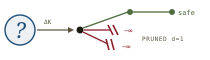
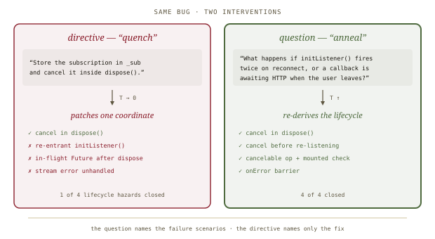
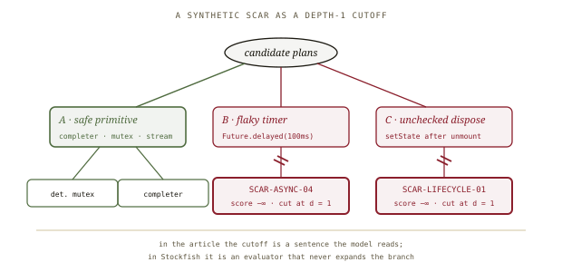
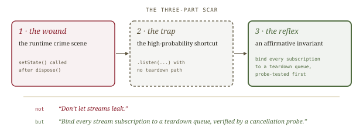

# Socratic Prompting, *questioned*

*Cliff notes on Randal L. Schwartz's "The Physics of Socratic Prompting: Somatic Recoil, Chess Alpha-Beta, & The NLP Meta-Model" (dev.to, 1 October 2026), Part 3 of the* Synthetic Scars *series ([[synthetic-scars]]). The essay argues for asking instead of patching, with a "scar" that prunes a known trap at depth 1. Harebrain reads that scar as a transition guard and a utility veto, written into the prompt where the brain can still ignore it.*

---

## The claim, under five metaphors

Part 3 is the series' theory chapter. It has no benchmark and no field data. It stacks five analogies, each meant to explain why barking line-level fixes at a coding agent fails, and what to do instead:

| Metaphor | What it is made to explain |
|---|---|
| **The Google Maps dumpster shortcut** | Scalar RLHF can't assign credit. A thumbs-down smears one bit of penalty across a twenty-minute trip; a thumbs-up rewards the dumpster alley. |
| **The pond** | A transformer computes by interference, not by stepping through instructions. *"You cannot single-step a pond. You have to reshape the shoreline."* |
| **Quench vs. anneal** | A direct fix is rapid cooling that freezes the code into the nearest local minimum. A Socratic question "reheats" the model so it explores the lifecycle. |
| **Alpha-beta pruning** | A *synthetic scar* gives a known trap a score of `−∞` and cuts that branch at depth `d = 1`, before the reasoning budget is spent rationalizing it. |
| **Somatic markers & the NLP Meta-Model** | A senior engineer's wince is compressed incident memory. Bugs come from *generalization*, *deletion* and *distortion* of the problem's Deep Structure. |

They all lead to one practice: stop being the **human compiler** (the one who reads every line and dictates every fix) and become the **flight director** (the one who asks questions, holds the invariants and watches the telemetry).

## The worked example, redrawn

The only concrete evidence in the piece is one Dart widget. The widget listens to an event stream and calls `setState` after `dispose`. The essay handles it two ways:

*The essay's own example, scored by its own count. Read the two prompts in the boxes, though: the question lists the failure scenarios and the directive doesn't.*

The directive (*"store the subscription in `_sub` and cancel it in `dispose()`"*) gets exactly what it asked for. The question (*"what happens if `initListener()` fires twice on reconnect, or a callback is awaiting HTTP when the user leaves?"*) gets the full repair: cancel-before-relisten, a `CancelableOperation` with a `mounted` check, and an `onError` barrier.

> **The confound the piece doesn't name.** The two prompts differ in more than grammatical mood. The question *contains the test cases*: reconnect twice, in-flight HTTP, user leaves. The directive contains only the fix. A directive that named the same scenarios ("guard against double `initListener()`, in-flight callbacks after dispose, and stream errors") would very likely do as well. What the example shows is that **naming the failure scenarios** beats **naming the patch**. Whether the question mark adds anything beyond that is untested.

## The scar as a depth-1 cutoff

The load-bearing idea is the **synthetic scar**. It is a registry entry with an ID (`SCAR-ASYNC-04`, *"The Sleep-Wait Race Hazard"*) that the agent is "inoculated" with before it starts planning. When a candidate plan intersects a known trap domain, the scar gives it `−∞` and the branch is never explored:

*The article's pruning diagram, redrawn. The footer marks the gap: in a chess engine the cutoff is code; in a prompt it is a request.*

Each scar has a three-part anatomy, and that anatomy is the most reusable thing in the piece:

*Wound → trap → reflex. The reflex is always an affirmative invariant, never a "don't".*

The affirmative phrasing comes from the essay's "Pink Elephant" argument. A negative rule (*"do not write unawaited futures"*) puts attention on exactly the tokens it forbids, and under load the "do not" fades before the concept does. *"You cannot ban a negative without providing an affirmative attractor."* This is the most actionable rule in the piece, and Part 3.8 ([[pretraining-gravity]]) comes back to it.

## What the physics is, and isn't

The essay calls itself *physics*. It's better read as a set of good habits explained by metaphors, and some of the metaphors are borrowed loosely:

- **Annealing isn't happening.** `T_effective = T₀ + γ·ΔK` is decoration. A user's question doesn't change the sampling temperature, which the API fixes. The simpler explanation is the confound above: the question carries more information.
- **It isn't alpha-beta either.** Alpha-beta pruning drops branches that provably can't change the minimax value. It is an *exact* optimization and returns the same answer as full search. Giving a known trap `−∞` is a hard constraint, or a heuristic veto. That's a fine idea, but it's a different one. The difference matters, because alpha-beta is safe by proof and a veto is only as good as the registry behind it.
- **The cognitive scaffolding is contested.** The NLP Meta-Model (Bandler & Grinder, 1975) has weak empirical standing in psychology. Chomsky later moved away from the Deep Structure / Surface Structure framing. The somatic marker hypothesis is still debated. As a *taxonomy*, though, generalization / deletion / distortion is a handy set of questions to put to a code review, whatever the neuroscience says.
- **No measurements.** One example, written by the author on both sides, plus a scar registry described as "soon-to-be-published". The numbers arrive in later parts ([[makefile-not-checklist]], [[init-d-compaction]], [[pretraining-gravity]]). This part should be cited for its *vocabulary*, not as evidence.
- **The RLHF framing is half right.** Scalar preference rewards really do assign credit poorly. But the fix the essay describes (scars, Socratic questions) works at inference time. It doesn't change training, and the Google Maps story doesn't say otherwise.

> **The advice survives the physics.** Name the failure scenarios instead of the patch. Write standing rules as affirmative invariants. Record every real failure as wound → trap → reflex. None of these needs annealing or alpha-beta to be true, and each is cheap to try.

## Where this sits in the harebrain hypothesis

The harebrain thesis is `harebrain = fast LLM brain × structured game-AI cage`. Part 3 is unusual among sources: it starts by arguing *against* treating the model as a program, and ends up building cage parts anyway. A scar registry is a guard catalogue. A `−∞` cutoff is a veto. The flight director is the AI Director. Everything lines up. The one difference is *where* each part runs.

*Same parts, different housing. The essay installs them in the prompt; harebrain installs them in the chart.*

| Socratic prompting | harebrain |
|---|---|
| Scalar thumbs-down (credit smeared over the trip) | Per-transition trace: a failure is pinned to one edge of the chart |
| Socratic precision question | An EDD expectation / soft-critic prompt: the scenarios the evidence must cover |
| Synthetic scar (wound · trap · reflex) | A transition guard with provenance: incident → test → predicate |
| `−∞` cutoff at `d = 1` | A utility veto (a zero consideration in the multiplicative scorer) or a removed edge |
| Permanent reflex (affirmative invariant) | A positively phrased guard predicate, e.g. `[sub_bound_to_teardown]` |
| Meta-Model traps (generalize · delete · distort) | Three axes for the critic bank to check |
| The senior's wince | The human on the slow clock, turning incidents into guards |
| Flight director | The AI Director: an outer loop that watches the inner loop |
| The pond (can't single-step it) | The cage: the part you *can* single-step |

### What the piece gives harebrain

- **The pond argument, turned around.** Schwartz says you can't debug a transformer by single-stepping it. Harebrain agrees, and concludes that *everything except the leaf* should be single-steppable: chart topology, guards, the blackboard, the utility scores. The pond is the reason the brain gets confined to one call per state. It's the clearest one-line case for the cage this series offers.
- **Scar anatomy as a format for guard provenance.** Every harebrain guard should be able to answer the scar's three questions. *Wound:* which incident or failing test justifies this guard? *Trap:* what tempting move does it block? *Reflex:* what positive predicate must hold? A guard catalogue with IDs and wounds is reviewable. A list of bare predicates is not.
- **Affirmative phrasing for whatever stays in the prompt.** Leaf instructions are the part of harebrain that the model *does* interpret. The Pink Elephant rule applies there in full: state each leaf's contract as what must be true on exit, not as a list of forbidden moves.
- **The Socratic question as a soft-critic template.** A soft critic that *asks scenario questions* ("what happens on reconnect?") instead of handing down a grade is EDD's adversarial review in its sharpest form ([[expectation-driven-development]]). It also matches the confound above: the critic's value lies in naming the scenarios.

### What harebrain pushes that the piece doesn't

- **Move the cutoff out of the prompt.** In Stockfish, `−∞` is computed by an evaluator, and the pruned branch is never generated. In the essay, `−∞` is a number the model is *asked to believe* about its own candidates. Harebrain's version is structural. The utility scorer multiplies a zero consideration and the candidate scores nothing, or a guard removes the edge so the state is unreachable. Either way the brain never gets the option. That's what the alpha-beta metaphor promises and what a prompt can't deliver.
- **Credit assignment by construction.** The Google Maps complaint is that one bit of feedback can't locate the bad turn. A chart's trace can: the run failed *on this transition, with this guard, reading this blackboard slot*. Harebrain gives the human on the slow clock pre-localized wounds, which is exactly the raw material a scar needs.

> **The trap to mark: a scar the model reads is not a scar the runtime enforces.** A registry of `SCAR-*` entries in the system prompt is still prose, and prose can be outweighed, misread or summarized away. The OpenClaw incident ([[openclaw-emails]]) is a safety rule compacted out of existence, and Part 3.7 ([[init-d-compaction]]) is the series' own answer to that failure. A harebrain workflow that keeps its scars only in the leaf prompt has the essay's vocabulary and the essay's guarantees, which is to say none.

## What's worth taking away

- The worked example really shows that **naming failure scenarios beats naming patches**. The Socratic mood is probably incidental. Use the scenarios either way.
- **Wound → trap → reflex** is a good provenance format for any guard, critic or rule. Harebrain's guard catalogue should adopt it, IDs included.
- **Affirmative invariants over prohibitions** for everything the model still has to read. This is the essay's most actionable claim, and later parts back it with numbers.
- The "physics" is metaphor. Annealing and alpha-beta are borrowed names for "give more information" and "veto known traps". Cite this part for vocabulary, not evidence.
- The `−∞` cutoff belongs in the cage, as a utility veto or a removed edge, not in the prompt. The pond argument is the series' best case for putting it there.

---

**Sources.** Schwartz, R. L. "The Physics of Socratic Prompting: Somatic Recoil, Chess Alpha-Beta, & The NLP Meta-Model." *DEV Community* (Google Developer Experts organization), 1 October 2026. Part 3 of the *Synthetic Scars* series. [dev.to/gde/the-physics-of-socratic-prompting-…-2b6e](https://dev.to/gde/the-physics-of-socratic-prompting-somatic-recoil-chess-alpha-beta-the-nlp-meta-model-2b6e). Works the essay names, with standard references added here: Bandler, R. & Grinder, J., *The Structure of Magic* (1975), the NLP Meta-Model; Damasio, A., *Descartes' Error* (1994), the somatic marker hypothesis; Knuth, D. E. & Moore, R. W., "An Analysis of Alpha-Beta Pruning," *Artificial Intelligence* 6 (1975); Kirkpatrick, S., Gelatt, C. D. & Vecchi, M. P., "Optimization by Simulated Annealing," *Science* 220 (1983). Companion summaries: [[synthetic-scars]] (series overview), [[teaching-pain]], [[nudging-with-questions]], [[pretraining-gravity]], [[expectation-driven-development]], [[openclaw-emails]]. All diagrams above are original SVGs drawn for this page.
