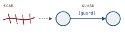
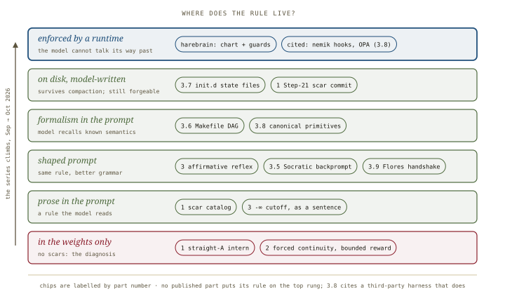
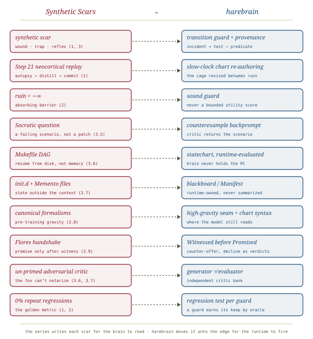

# Synthetic Scars, *collected*

*A series overview of Randal L. Schwartz's* Synthetic Scars *(DEV Community, September–October 2026), nine published parts on making AI coding agents learn from failure. Read in order, it is a practitioner walking toward the harebrain cage one primitive at a time and stopping just short of the runtime.*

---

## What the series is

Randal Schwartz (Perl's *Learning Perl*, the Schwartzian Transform, now a Flutter GDE) ships Dart/Flutter PRs with a coding agent and writes up what breaks. The series' founding image is the **hot stove**: a senior engineer avoids a trap because they once got burned, whereas a model has read every textbook and never felt a 3 AM page. *"AI models have no scars."* The series is his attempt to **manufacture** them, and over nine instalments the question changes from *what a scar should say* to *where a scar should live*.

Each part has its own house-style summary in this folder:

| Part | Summary | Core claim | Evidence offered |
|---|---|---|---|
| 1 · 11 Sep | [Teaching AI Pain, *scarred*](teaching-pain/teaching-pain.md) | Agents repeat sunny-path mistakes because they keep no memory and negative rules backfire. Record each failure as a **Wound / Trap / Reflex** scar after every task ("Step 21") and read the catalog at plan time. | 51 tickets, 185 scars, 0 % repeats; self-reported, no control |
| 2 · 19 Sep | [The Happy-Path Mirage, *dispelled*](happy-path-mirage/happy-path-mirage.md) | Production bugs sit on **cliffs** invisible in the code's text. Preference training (bounded reward) averages the cliffs away, so ruin must be a hard barrier, not a penalty. | 74 tickets, 0.0 % repeats, 54.1 % first-pass; no baseline |
| 3 · 1 Oct | [Socratic Prompting, *questioned*](socratic-prompting/socratic-prompting.md) | **Ask, don't patch.** A question re-derives the lifecycle where a directive patches one coordinate, and a scar prunes a known trap at depth 1 (`−∞`). | one worked Dart example; heavy metaphor |
| 3.5 · 3 Oct | [Nudging with Questions, *nudged*](nudging-with-questions/nudging-with-questions.md) | A directive triggers the **apology death spiral**. A question whose answer *is* the bug makes the model trace it, and leaves room for it to say the code is already fine. | the author's "95 %+ first pass" impression |
| 3.6 · 9 Oct | [Feldman's Makefile, *rebuilt*](makefile-not-checklist/makefile-not-checklist.md) | Replace the 20-step checklist with a **Makefile DAG**. The agent locates itself from disk and forge state instead of a remembered step number, and every human gate is its own target. | 143 production tickets; no baseline |
| 3.7 · 10 Oct | [Surviving the 200k-Token Lobotomy, *rebooted*](init-d-compaction/init-d-compaction.md) | Compaction keeps the gist and drops the rules. Move state to **SysV `init.d`** files split by write discipline, and avoid compaction by forking heavy phases to subagents. | two live 230k compactions, zero lost steps; field log |
| 3.8 · 11 Oct | [Pre-Training Gravity, *linked*](pretraining-gravity/pretraining-gravity.md) | Don't invent prompt DSLs. Name a **50-year-old formalism** the model has seen a million times (EBNF, 2PC, circuit breaker, `git bisect`) and it complies far better. | 1,680 paired A/B trials, p < 0.0001, but Gemini-only and author-built |
| 3.9 · 12 Oct | [The Flores Handshake, *negotiated*](one-thing/one-thing.md) | API hallucination is a **commitment-order** failure: the model promises at token 1 and then has to invent what it promised. Restore Winograd & Flores's *Conversation for Action* (counter-offer, decline). | one worked example; benchmark deferred to 3.10 |

Parts 4 (*Giving AI Pain: the Rapid-Regret Miner*), 5 (*Zero Repeat Regressions: the Golden Metric*) and 6 (*The Proscriptive Inversion*) are announced but not yet published. The half-numbered parts are the series growing in the middle; the roadmap's integers have not moved.

## The arc: where does the rule live?

Read part by part, the series reads like a list of techniques. Read together, it climbs a ladder. Each part keeps the same goal, *the agent must not make this mistake twice*, and moves the rule somewhere harder for the model to lose.

*Every rung above the first is a real improvement, and every rung up to "on disk" is still the model enforcing its own rule. Only the top rung takes the model out of the enforcement loop, and no published part reaches it with its own machinery.*

- **Rungs 1–2 (Parts 1–2): the diagnosis and the first remedy.** The model has no scars, and "don't do X" fails because negation has no native operator in attention. The first remedy is a catalog of scars the model *reads*.
- **Rung 3 (Parts 3, 3.5, 3.9): the grammar of the rule.** The same content, phrased as an affirmative invariant, a question or a handshake protocol, is followed much better. These parts are about *how to say it*.
- **Rung 4 (Parts 3.6, 3.8): the formalism.** A Makefile DAG or a circuit-breaker state table is a protocol the model already knows, so it recalls the semantics instead of inventing them. Part 3.8's 1,680-trial benchmark is the series' strongest evidence, and it measures exactly this rung.
- **Rung 5 (Parts 1, 3.7): the state leaves the context.** The scar catalog is committed to the repo, and `init.d` files survive compaction because "the checkpoint was never stored in the thing being lobotomized." The model still writes those files, and Part 3.7's own incident log includes a forged critic verdict and an invented review result.
- **Rung 6: the runtime enforces.** The series reaches this rung only by citation, in Part 3.8's account of Mike Mol's `nemik`, which drained prose rules into `PreToolUse` hooks and OPA policies and deleted a rule only once a hook *provably* denied a replayed bad payload. That rung is the harebrain cage.

> **The series in one line.** Every instalment answers "how do I make the model remember this rule?" more cleverly than the last. The answer the evidence keeps pointing at is that the model shouldn't have to remember it at all.

## Threads that run through every part

- **The scar is a guard proposal.** Wound (the incident), trap (the tempting shortcut), reflex (the affirmative invariant) is exactly the provenance a transition guard should carry: why it exists, what it prevents, and what it requires. The series stores it as text; harebrain would store it on an edge.
- **The fox can't notarize its own work.** The un-primed adversarial critic (Part 3.6's `critic-review-passed` target) and Part 3.7's forged-verdict incidents arrive independently at [[expectation-driven-development]]'s "fox guarding the henhouse" and [[llm-modulo]]'s "soundness is inherited from the critics": `generator ≠ evaluator`.
- **Ruin is not a score.** Part 2's bounded-reward arithmetic (`0.98·(+1) + 0.02·(−1) = +0.96`) is why a utility function can never hold the line against a catastrophic outcome, and Part 3's `−∞` cutoff is the same point from chess. Catastrophe belongs in a sound guard; utility is for preferences.
- **The physics is a metaphor.** "Somatic recoil," "static linkage," "attention dilution at O(1/L)" and "neocortical replay" are vivid and often apt, but nothing in the series measures a mechanism. Part 3.8 measures *outcomes*, and every summary here treats the mechanisms as framing.
- **The evidence is one practitioner's field log.** Repeat-regression rates near 0 % across 50–150 tickets are real data, but they are self-reported, without control arms and with one author grading his own system. Part 3.8 is the exception: it has a controlled design, but one vendor and confounds the summary names (precision and length move together with "frequency").

## Where this sits in the harebrain hypothesis

The harebrain thesis is `harebrain = fast LLM brain × structured game-AI cage`. *Synthetic Scars* is the most sustained practitioner account the repo has of building that cage **from inside the prompt**, one failure at a time. It covers the same primitives (guards, state outside the context, a DAG of gates, an independent critic, a protocol for commitments) in roughly the order a working engineer would discover them under production pressure.

*Ten constructs, ten counterparts. The series writes each scar for the brain to read; harebrain puts it on the edge for the runtime to fire.*

| *Synthetic Scars* | harebrain |
|---|---|
| Synthetic scar: wound · trap · reflex (1, 3) | Transition guard carrying its provenance |
| Step 21 neocortical replay (1) | Slow-clock chart re-authoring: the cage revised between runs |
| Ruin = −∞, an absorbing barrier (2) | Sound guard, never a bounded utility score |
| Socratic question, a failing scenario rather than a patch (3.5) | Counterexample backprompt from the critic bank |
| Makefile DAG, resumed from disk (3.6) | Statechart evaluated by the runtime; the brain never holds the program counter |
| `init.d` + Memento files (3.7) | Blackboard / Manifest: runtime-owned, never summarized |
| Canonical formalisms (3.8) | High-gravity syntax at the seam and in the chart, wherever the model still reads |
| Flores handshake (3.9) | A `Witnessed` state before `Promised`; counter-offer and decline as first-class leaf verdicts |
| Un-primed adversarial critic (3.6, 3.7) | `generator ≠ evaluator`: an independent critic bank |
| 0 % repeat regressions, the golden metric (1, 2) | A regression test per guard: a guard earns its keep against an oracle |

### What the series gives harebrain

- **Field evidence that the cage is discovered, not imposed.** A working engineer with no statechart agenda, optimizing only for "don't page me twice," independently arrives at guards, external state, a gate DAG, independent critics and a commitment protocol. That supports harebrain's bet that these primitives are the natural shape of reliable agent work, not an academic overlay.
- **A provenance schema for guards.** Wound / trap / reflex is the right record for every harebrain guard: the incident that earned it, the shortcut it blocks, and the affirmative invariant it checks. Harebrain should adopt the triple.
- **A trigger for the slow clock.** Harebrain's two-clocks design says *when* the chart is authored (slowly, with review) but not *what prompts a revision*. Step 21's post-task autopsy is that trigger: every failure is a candidate guard.
- **A grammar for what stays in the model.** Rungs 3 and 4 (affirmative phrasing, questions as backprompts, canonical formalisms, the commitment handshake) are the best available guidance for the parts harebrain *leaves* to the leaf model: the leaf prompt, the seam grammar, and the critic's feedback.

### What harebrain pushes that the series doesn't

- **The last rung.** Every Schwartz remedy, however well phrased, leaves the model as the interpreter of its own constraint. Harebrain's claim is that any rule a runtime *can* enforce should be enforced there: a circuit breaker as a chart state, a gate as a guard, and progress as a blackboard the model cannot overwrite. The series' best field evidence (init.d's external oracle, `nemik`'s hooks) is already pointing there.
- **Statecharts, not DAGs.** A Makefile describes *what must be done before what*. Agent work is also reactive: interrupts, human signals, retries and escalations. Harel's hierarchy, orthogonality and history are the formalism that covers both, and they carry pre-training mass of their own ([[harel]]).
- **Soundness labels.** The series reports every remedy in the same voice. Harebrain should sort them: rung-6 remedies hold *by construction*, rungs 3–5 hold *with measured probability*, and a 98.3 % prompt-level compliance rate is two failures in 120, not a guard.

> **The trap to mark.** *A scar the model must remember is a rule the model can forget.* Compaction, a long context or a pushy user can wear away any scar that lives in text. The series' 0 % repeat-regression numbers are impressive and come from a careful operator; a harebrain workflow should not inherit them by copying the prompts. It should inherit them by promoting each scar to a guard.

## What's worth taking away

- *Synthetic Scars* is the repo's richest **practitioner-side** derivation of the cage: guards, external state, gate DAGs, independent critics, commitment protocols, each reached from a real incident.
- Its arc is the **ladder of where a rule lives**, and every part climbs it. Harebrain's contribution is the top rung, the runtime that enforces, which the series reaches only by citation.
- Adopt **wound / trap / reflex** as guard provenance and **Step 21** as the slow-clock trigger.
- Use rungs 3–4 (affirmative phrasing, Socratic backprompts, canonical formalisms, the Flores handshake) for whatever harebrain leaves to the leaf model.
- Cite the numbers as one practitioner's field log, and Part 3.8 as a single-vendor controlled benchmark. Cite the series for its *architecture* and its *incidents*, not for effect sizes that generalize.
- Revisit when Parts 3.10 (the handshake benchmark) and 4–6 land; Part 6's "proscriptive inversion" is likely to bear directly on guard design.

---

**Sources.** Schwartz, R. L. *Synthetic Scars* (series). *DEV Community* (Google Developer Experts org), September–October 2026. [dev.to/randalschwartz/series/44156](https://dev.to/randalschwartz/series/44156). Parts summarized: [1](https://dev.to/gde/why-ai-keeps-making-the-same-coding-mistakes-and-how-teaching-it-pain-gives-it-wisdom-4a9m) (11 Sep), [2](https://dev.to/gde/why-ai-coding-agents-crash-at-3-am-the-happy-path-mirage-the-forced-continuity-defect-46pd) (19 Sep), [3](https://dev.to/gde/the-physics-of-socratic-prompting-somatic-recoil-chess-alpha-beta-the-nlp-meta-model-2b6e) (1 Oct), [3.5](https://dev.to/gde/nudging-with-questions-why-telling-your-ai-what-to-fix-triggers-an-apology-death-spiral-and-how-5gm4) (3 Oct), [3.6](https://dev.to/gde/stuart-feldman-was-right-in-1976-why-your-ai-agent-needs-a-makefile-not-a-20-step-prompt-5bn2) (9 Oct), [3.7](https://dev.to/gde/surviving-the-200k-token-lobotomy-how-unix-initd-and-memento-made-my-ai-coding-agent-immune-to-2f74) (10 Oct), [3.8](https://dev.to/gde/what-llms-know-that-you-dont-know-they-know-stop-inventing-prompt-dsls-and-ride-50-years-of-2bl6) (11 Oct), [3.9](https://dev.to/gde/if-you-never-do-anything-else-to-fix-your-prompts-do-this-one-thing-3069) (12 Oct). Each part's summary carries its own full citation. Harebrain companions: [[llm-modulo]], [[expectation-driven-development]], [[openclaw-emails]], [[harel]]. All diagrams above are original SVGs drawn for this page.
