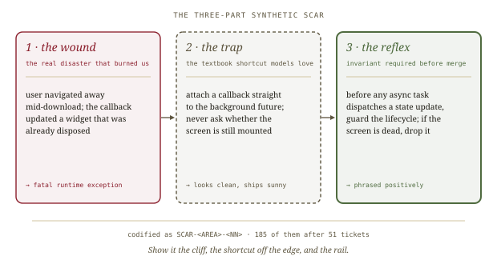
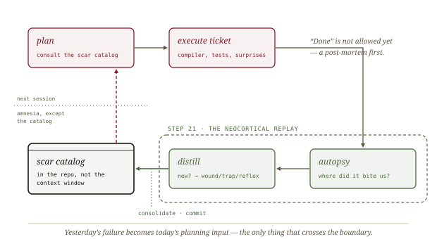
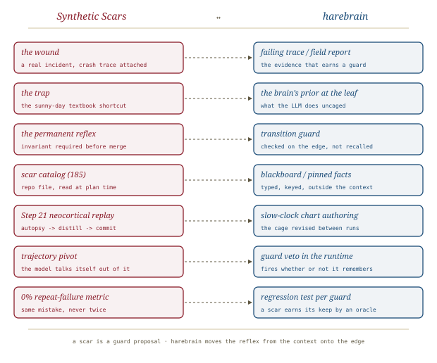

# Teaching AI Pain, *scarred*

*Cliff notes on Randal L. Schwartz's "Why AI Keeps Making the Same Coding Mistakes—And How Teaching It Pain Gives It Wisdom" (dev.to, September 2026). This is Part 1 of the* Synthetic Scars *series and its founding metaphor. In harebrain terms, a scar is a transition guard that hasn't been moved onto the edge yet.*

---

## The problem: the straight-A intern

Schwartz opens with a failure every agent user knows. The model writes clean, idiomatic, well-commented code that passes the toy test. Then, in a real project, it double-fires on a double tap, leaks a stream subscription, or assumes a 50 ms network. Correct it on Monday and it apologizes, fixes the line, and makes the same mistake on Thursday in another file.

He calls this **the Straight-A Intern Paradox**, and the diagnosis is about training data. The corpus is tutorials, homework and blog posts, where "the weather is always sunny." Inputs are valid, databases stay up, and nobody backgrounds the app for three weeks. Production is "95 % sad path." The model drifts toward the most common pattern it has seen, and the most common pattern is the happy path. (Part 2, [[happy-path-mirage]], builds the whole argument on this point.)

## Why "don't do that" doesn't hold

The usual first fix is a rules file: *don't use mutable lists in state, always cancel subscriptions, never mutate shared state across async boundaries.* Schwartz names two reasons it fails:

- **The pink-elephant trap.** A negative rule puts the forbidden tokens into context, where they draw attention. Under load the model fixates on the forbidden pattern, or argues itself into treating this case as an exception. (Part 3.8, [[pretraining-gravity]], comes back to this: swapping `NOT` for `!` gives softmax attention no negation operator.)
- **Statistical amnesia.** Every new conversation starts from zero. Yesterday's three-hour debugging session, the rollback and the angry email are all gone. Every task is Day One, a permanent *Groundhog Day*.

## The hot stove

The human counterexample is the veteran who recoils from a pull request before compiling it: *"No. That's going to blow up in production."* Schwartz explains that recoil with Damasio's **Somatic Marker Hypothesis** (1994). A painful outcome records a visceral marker, and the next approach to the stove triggers recoil before any deliberate analysis. Veterans carry scar tissue: the unindexed query of 1998, the battery-draining leak of 2011, the ledger-corrupting race of 2020.

> **The thesis in one line.** *AI models have no scars.* Bigger rulebooks won't fix that. "We have to give them scars."

## The anatomy of a synthetic scar

A **synthetic scar** is the series' unit of institutional memory. Schwartz calls it "an impassable cognitive barrier, not a polite suggestion," and gives it a strict three-part shape:

*Every scar has the same three parts: what burned us, the shortcut that leads to it, and the invariant that blocks it.*

| Part | What it records | The worked example |
|---|---|---|
| **Wound** | The real incident, with its crash trace, leak, or corrupted output | Navigating away mid-download made a callback update a widget that had already been disposed, causing a fatal runtime exception |
| **Trap** | The tempting textbook shortcut models love because it looks clean | Attach a callback straight to the background future and never check whether the screen is still mounted |
| **Permanent reflex** | The non-negotiable invariant that must hold before code is written or merged | Before any async task dispatches a state update, guard the lifecycle; a dead screen means the payload is dropped |

The schema is the best idea in the piece. Two details make it work. First, the *wound* is concrete evidence, not a platitude, so the rule carries its own justification. Second, the *reflex* is phrased as a positive obligation ("verify lifecycle viability") rather than a prohibition. That positive phrasing is the real answer to the pink-elephant problem. The *trap* section, though, still names the forbidden pattern explicitly. A scar is therefore a negative example placed in context next to the positive rule meant to override it, and the piece never addresses that tension.

## Step 21: sleeping on the job

The second mechanism is how scars get made. Schwartz borrows **memory consolidation**: in slow-wave sleep the hippocampus replays the day and writes what matters into the neocortex. His workflow does the same and calls it **Step 21: the Neocortical Replay**.

*The agent may not mark a ticket done and disappear. The post-mortem is mandatory, and its output is the next session's planning input.*

1. **Autopsy.** The agent reviews its own trajectory: where the compiler complained, where the tests failed, what surprised it.
2. **Distillation.** Any *new* failure mode becomes a Wound / Trap / Reflex scar.
3. **Consolidation.** The scar is committed into the project's permanent memory repository.

The next agent, in a fresh window, reads the updated catalog during planning. "The organization stops having *Groundhog Day*. It starts building cumulative institutional wisdom."

## The scorecard, and how much it can carry

The evidence is 51 consecutive production tickets across two codebases: the author's open-source `BlocSignal` Flutter framework and an enterprise geotechnical-telemetry monorepo.

| Metric | "Traditional AI coding" | Synthetic-scar agent |
|---|---|---|
| Repeat-failure rate | ~40–50 % | **0.0 %** |
| Autonomous first-pass success | ~24 % | **52.9 %** |
| Institutional memory | 0 scars | **185 scars** |

There is also **cognitive-deflection telemetry**. Across about 14,600 thinking turns the author found 78 *trajectory pivots*. In each one the model started drafting the naive pattern, hit a scar ("Wait. SCAR-ASYNC-03 states…"), and switched to the guarded version on the first try.

This evidence should be read for exactly what it is:

- **No controlled arm.** The baselines are approximate (`~40–50 %`, `~24 %`) and come with no method, no source, and no indication they were measured on the same tickets. This is one author's longitudinal field log, not an A/B test. (Part 3.8's 1,680-trial benchmark is the series' attempt at a controlled study, and it tests different claims.)
- **The 0 % metric partly defines its own success.** "Never made *that exact* mistake again" is scored against a catalog that grew to 185 entries over 51 tickets, about 3.6 new scars per ticket. Novel mistakes keep happening; they become new scars and never count as repeats. A falling *novel-failure* rate would show learning. A zero repeat rate on catalogued failures mainly shows that recall works.
- **Thinking traces are testimony, not causation.** Seventy-eight pivots in 14,600 turns is about 0.5 %, and reasoning traces are not guaranteed to reflect what actually drove the output. The telemetry shows the scar was *cited*. It does not count the misses, where a scar applied and the model ignored it.
- **The formal backing is a promise.** The "Hamiltonian energy landscape models" and "asymmetric barrier topologies" are attributed to a forthcoming preprint. Until it exists, the physics is vocabulary.
- **The neuroscience is inverted.** A somatic marker works *before* deliberation. A scar works by being *read*, in context, at plan time, and is followed by explicit reasoning. That is deliberate, not somatic. The metaphor is memorable but the mechanism is retrieval: a curated lessons-learned file with an excellent schema. That is still worth having.

> **The fair reading.** The architecture is plausible and the schema is good. The numbers are one practitioner's field log and should be cited as practice, not as a measured effect size.

## Where this sits in the harebrain hypothesis

The harebrain thesis is `harebrain = fast LLM brain × structured game-AI cage`. Part 1 describes the same disease harebrain describes: a fluent brain with no durable memory, drifting to its prior. It prescribes half the cure, because the scar is *structure* (a typed, three-part record that persists outside the model) delivered to the brain *as context*. Harebrain's move is the other half: put the reflex where the model can't forget it.

*A scar is a guard proposal. Harebrain moves the reflex out of the context and onto the edge.*

| Synthetic Scars | harebrain |
|---|---|
| The wound (incident + trace) | Failing trace / field report: the evidence that earns a guard |
| The trap (textbook shortcut) | The brain's prior at the leaf: what the LLM does uncaged |
| The permanent reflex | Transition guard, checked on the edge instead of recalled |
| Scar catalog (185 entries) | Blackboard / pinned facts: typed, keyed, outside the context |
| Step 21 neocortical replay | Slow-clock chart authoring: the cage revised between runs |
| Trajectory pivot (in the thought) | Guard veto in the runtime, which fires whether or not the model remembers |
| 0 % repeat-failure metric | A regression test per guard: a scar earns its keep by an oracle |

### What the piece gives harebrain

- **A schema for guard provenance.** Harebrain's guards currently arrive without a history. Wound / Trap / Reflex is the right minimum record for *why a guard exists*: the incident that justifies it, the default behaviour it overrides, and the invariant it enforces. Every non-obvious transition guard in a harebrain chart should carry those three fields.
- **The slow clock, made routine.** Harebrain's two-clock pattern (the LLM helps author the cage slowly, the cage runs fast) has never had a *trigger* for re-authoring. Step 21 supplies one: a mandatory post-mortem at the end of every run that proposes new structure. That is the slow clock as a habit rather than a project.
- **A field name for the disease.** The Straight-A Intern Paradox is the plain-language version of LLM-Modulo's claim that the brain can't verify itself ([[llm-modulo]]). It is a good line for explaining the cage to people who haven't read the planning literature.

### What harebrain pushes that the piece doesn't

- **Enforcement, not recall.** In Part 1 the reflex works only if the model reads the catalog, retrieves the right scar, and chooses to obey it, three soft steps in a row. Harebrain puts the invariant in a transition guard, so the runtime refuses the edge regardless of what the model attended to. Where the reflex is mechanically checkable (a lint rule, a static check, a test), it becomes a *sound* guard, and the 0 % stops being a hope. [[agentspec]]'s trigger–predicate–enforce rule is that move with a syntax. The series reaches the same conclusion from inside: the `Makefile` and `init.d` parts ([[makefile-not-checklist]], [[init-d-compaction]]) progressively move state and ordering out of the model.
- **A review gate on consolidation.** In Step 21 the agent writes its own scars and commits them directly. That is `generator = evaluator` at the level of institutional memory. A mis-distilled scar (over-broad, wrong root cause, or written to justify what the agent already did) becomes a permanent reflex every future agent obeys. Harebrain's slow clock keeps a reviewer between proposal and promotion, which is [[expectation-driven-development]]'s *stabilize* step applied to guards.
- **Decay and relevance.** The catalog only grows: 185 scars after 51 tickets. Harebrain's blackboard has typed keys, ages and pinned-versus-decaying facts precisely so the brain reads a relevant slice rather than an ever-longer file. A scar catalog without scoping or retirement eventually reproduces the rulebook problem the series started from.

> **The trap, in the series' own terms.** *A scar the model must remember is a rule the model can forget.* Compaction, a long context, or one missed retrieval returns the agent to Day One, which is exactly how [[openclaw-emails]]'s "suggest, don't action" rule was summarized out of existence. A scar earns the word *permanent* only when the reflex lives somewhere the model can't edit or forget: on the edge, in the runtime, ideally with an oracle behind it.

## What's worth taking away

- **Wound / Trap / Reflex is a strong schema.** It is concrete, self-justifying, and states the reflex positively. Harebrain should adopt it as the provenance record for transition guards.
- **Step 21 is the slow clock's missing trigger.** A mandatory post-run autopsy that proposes new structure keeps the cage evolving with the codebase. Add a reviewer before anything is promoted.
- **The evidence is a field log, not an experiment.** No control arm, a self-defined repeat metric, and thinking-trace testimony. Cite it as practice.
- **Recall is the weak link.** Everything in Part 1 still depends on the model reading and heeding the catalog. The rest of the series ([[synthetic-scars]]) is, read one way, a steady migration of that dependency into structure the model can't skip, which is the harebrain thesis arrived at from the keyboard.

---

**Sources.** Schwartz, R. L. "Why AI Keeps Making the Same Coding Mistakes—And How Teaching It Pain Gives It Wisdom." *DEV Community* (gde), 11 September 2026. Part 1 of the *Synthetic Scars* series. [dev.to/gde/why-ai-keeps-making-the-same-coding-mistakes-and-how-teaching-it-pain-gives-it-wisdom-4a9m](https://dev.to/gde/why-ai-keeps-making-the-same-coding-mistakes-and-how-teaching-it-pain-gives-it-wisdom-4a9m). Background cited within: Damasio, A. *Descartes' Error* (1994), the Somatic Marker Hypothesis. Forthcoming preprint named within (not yet available): Schwartz, *Synthetic Scars: Mitigating Statistical Amnesia and Plausibility Bias in Autonomous Coding Agents via Asymmetric Barrier Topologies and Episodic Consolidation*. Series overview: [[synthetic-scars]]. All diagrams above are original SVGs drawn for this page.
